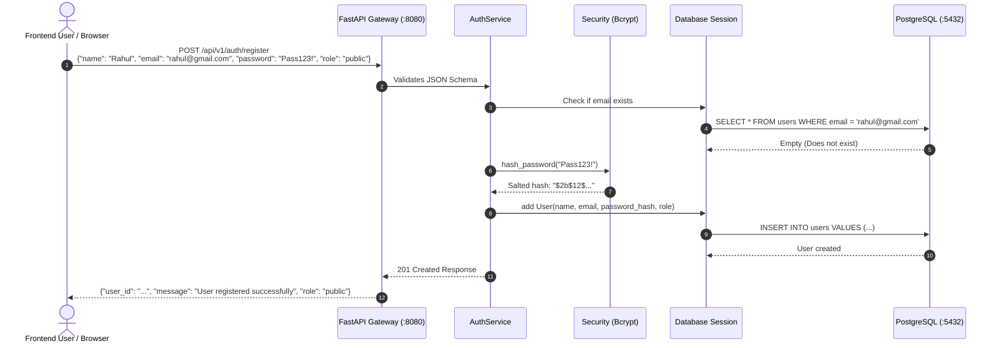
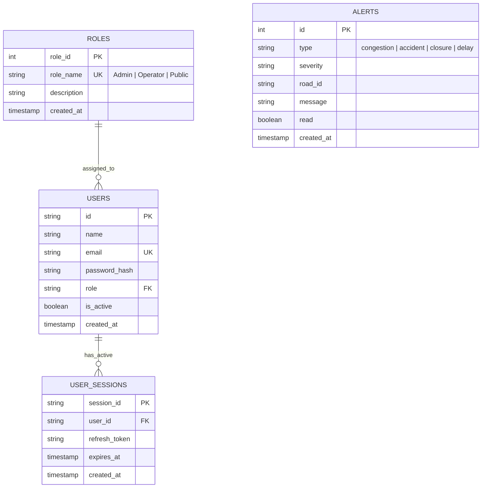

# TrafficVision AI — Comprehensive PostgreSQL Database & Setup Guide (`db.md`)

This guide is written for **beginners** to explain how to **install and set up PostgreSQL** from scratch on Windows, the exact **database credentials and passwords**, the **complete SQL schema for Authentication & Role-Based Access Control (RBAC)**, how user registration data is stored, and the essential commands to manage tables.

---

## 📑 Table of Contents

1. [Master Database Configuration & Credentials](#1-master-database-configuration--credentials)
2. [Complete SQL Schema Code for Authentication & RBAC](#2-complete-sql-schema-code-for-authentication--rbac)
   - [Full SQL Script (`aibin-backend/database/schema.sql`)](#full-sql-script-aibin-backenddatabaseschemasql)
   - [Detailed Table Structure & Columns Explanation](#detailed-table-structure--columns-explanation)
3. [How to Install PostgreSQL on Windows (Step-by-Step)](#3-how-to-install-postgresql-on-windows-step-by-step)
   - [Method A: One-Command Installation via Winget (Fastest)](#method-a-one-command-installation-via-winget-fastest)
   - [Method B: Graphical Installer (GUI Wizard)](#method-b-graphical-installer-gui-wizard)
4. [How to Initialize All Database Tables & Load Data](#4-how-to-initialize-all-database-tables--load-data)
   - [Step 1: Set Up Authentication & RBAC Schema (Intern 1)](#step-1-set-up-authentication--rbac-schema-intern-1)
   - [Step 2: Set Up Traffic Monitoring Schema (Intern 2)](#step-2-set-up-traffic-monitoring-schema-intern-2)
   - [Step 3: Import 1,000 Traffic Readings](#step-3-import-1000-traffic-readings)
5. [Permanent Admin & Demo Accounts](#5-permanent-admin--demo-accounts)
6. [Does User Registration Save Directly into PostgreSQL?](#6-does-user-registration-save-directly-into-postgresql)
7. [How to Start & Check PostgreSQL Service](#7-how-to-start--check-postgresql-service)
8. [Essential PostgreSQL Commands (`psql`) & SQL Queries](#8-essential-postgresql-commands-psql--sql-queries)
9. [Complete Database Schema Architecture (ER Diagrams)](#9-complete-database-schema-architecture-er-diagrams)

---

## 🔑 1. Master Database Configuration & Credentials

All microservices (`aibin-backend`, `anmol-data`, `saksham-aiml`) share the exact same PostgreSQL credentials configured in `.env` and `traffic_api.py`:

| Parameter | Value | Description |
|---|---|---|
| **Host** | `127.0.0.1` (or `localhost`) | Localhost database server |
| **Port** | `5432` | Standard PostgreSQL port |
| **Database Name** | `postgres` (or `trafficvision`) | Primary database |
| **Username** | `postgres` | Superuser administrative account |
| **Password** | **`A`** | Password set across all project configuration files |
| **Full Connection URL** | `postgresql://postgres:A@127.0.0.1:5432/postgres` | Used by FastAPI database engine |

---

## 📜 2. Complete SQL Schema Code for Authentication & RBAC

The Authentication and Role-Based Access Control (RBAC) database schema is located in [`aibin-backend/database/schema.sql`](file:///c:/Users/AIBIN%20SHIBU/OneDrive/Documents/trafficvision/aibin-backend/database/schema.sql).

### Full SQL Script (`aibin-backend/database/schema.sql`)

```sql
-- =========================================================
-- TrafficVision AI - PostgreSQL Schema for Authentication & RBAC
-- Owner: Intern 1 (Team Lead / Backend & Integration)
-- Scope: Milestone 1 (SRS 1 Section 6 & 7.1)
-- =========================================================

-- 1. ROLES TABLE
CREATE TABLE IF NOT EXISTS roles (
    role_id SERIAL PRIMARY KEY,
    role_name VARCHAR(50) UNIQUE NOT NULL,
    description TEXT,
    created_at TIMESTAMP DEFAULT CURRENT_TIMESTAMP
);

-- Seed Default Roles (Admin, Traffic Operator, Public/Commuter)
INSERT INTO roles (role_name, description)
VALUES 
    ('Admin', 'Full administrative control over the TrafficVision AI system and user management'),
    ('Operator', 'Traffic Control Operations personnel managing traffic lights, alerts, and live routing'),
    ('Public', 'General public / Commuters accessing live traffic summaries and congestion forecasts')
ON CONFLICT (role_name) DO NOTHING;


-- 2. USERS TABLE
CREATE TABLE IF NOT EXISTS users (
    user_id SERIAL PRIMARY KEY,
    name VARCHAR(100) NOT NULL,
    email VARCHAR(150) UNIQUE NOT NULL,
    password_hash VARCHAR(255) NOT NULL,
    role VARCHAR(50) NOT NULL DEFAULT 'Public',
    is_active BOOLEAN DEFAULT TRUE,
    created_at TIMESTAMP DEFAULT CURRENT_TIMESTAMP,
    updated_at TIMESTAMP DEFAULT CURRENT_TIMESTAMP,
    CONSTRAINT fk_user_role FOREIGN KEY (role) REFERENCES roles(role_name) ON UPDATE CASCADE
);

CREATE INDEX IF NOT EXISTS idx_users_email ON users(email);
CREATE INDEX IF NOT EXISTS idx_users_role ON users(role);

-- Seed Permanent Admin, Operator, and Public Accounts (with Bcrypt Passwords)
INSERT INTO users (name, email, password_hash, role)
VALUES 
    ('Admin User', 'admin@trafficvision.ai', '$2b$12$UVyjT6ijSPjwLS9rTtpr7OtvxQtk4GWrnQ9Tuu/7YJGbS65UH5f0G', 'Admin'),
    ('Traffic Operator', 'operator@trafficvision.ai', '$2b$12$dLf8B0zn4FLwABOB9Q1CZOQAT/.yalk3aR8skHH9KjtQ0yGDM8Upy', 'Operator'),
    ('Public Commuter', 'public@trafficvision.ai', '$2b$12$WrrN5qLR5cEVzUVrojGCJuaWkq9v6/q7Zypd0r3gCOWYHgk6H9ouO', 'Public'),
    ('Aibin Shibu', 'aibin@trafficvision.ai', '$2b$12$sq33.0mh8bL1oX/GySoTVeu/s9CEsWJcDO3sMXTP0EcsJb2o9EkNm', 'Admin')
ON CONFLICT (email) DO NOTHING;


-- 3. USER SESSIONS TABLE (For Refresh Token Tracking & Revocation)
CREATE TABLE IF NOT EXISTS user_sessions (
    session_id VARCHAR(100) PRIMARY KEY,
    user_id INTEGER NOT NULL,
    refresh_token TEXT NOT NULL,
    expires_at TIMESTAMP NOT NULL,
    created_at TIMESTAMP DEFAULT CURRENT_TIMESTAMP,
    CONSTRAINT fk_session_user FOREIGN KEY (user_id) REFERENCES users(user_id) ON DELETE CASCADE
);

CREATE INDEX IF NOT EXISTS idx_sessions_user_id ON user_sessions(user_id);
CREATE INDEX IF NOT EXISTS idx_sessions_expires_at ON user_sessions(expires_at);

-- 4. ALERTS TABLE (Milestone 3)
CREATE TABLE IF NOT EXISTS alerts (
    id SERIAL PRIMARY KEY,
    type VARCHAR(50) NOT NULL,
    severity VARCHAR(50) NOT NULL,
    road_id VARCHAR(50) NOT NULL,
    message TEXT NOT NULL,
    read BOOLEAN DEFAULT FALSE,
    created_at TIMESTAMP DEFAULT CURRENT_TIMESTAMP
);
```

---

## 🛠️ 3. How to Install PostgreSQL on Windows (Step-by-Step)

### Method A: One-Command Installation via Winget (Fastest)

1. Open **PowerShell as Administrator** (Right-click Windows Start button -> Select "Terminal (Admin)" or "PowerShell (Admin)").
2. Run the automated installer command setting the default password to `A`:
   ```powershell
   winget install PostgreSQL.PostgreSQL.16 --accept-package-agreements --accept-source-agreements --override "--unattendedmodeui none --superpassword A --serverport 5432"
   ```
3. If Windows displays a **User Account Control (UAC)** prompt, click **Yes**.
4. Once completed, PostgreSQL will automatically start as a Windows background service!

---

### Method B: Graphical Installer (GUI Wizard)

1. **Download:** Go to the official PostgreSQL Windows download page:
   👉 **[https://www.enterprisedb.com/downloads/postgres-postgresql-downloads](https://www.enterprisedb.com/downloads/postgres-postgresql-downloads)**
   Download version **16.x** or **17.x** for Windows x86-64.
2. **Run Installer:** Double-click the downloaded `.exe` file.
3. **Installation Directory:** Keep default (`C:\Program Files\PostgreSQL\16` or `17`).
4. **Components:** Keep all checked (`PostgreSQL Server`, `pgAdmin 4`, `Command Line Tools`).
5. **Password Step (CRITICAL):**
   When the installer prompts **"Password"**, type:
   👉 **`A`**
   *(Retype `A` in the confirmation box).*
6. **Port:** Leave as default **`5432`**.
7. **Locale:** Leave as default `[Default locale]`.
8. Click **Next** to finish installation. (Uncheck "Stack Builder" at the end).

---

## 📥 4. How to Initialize All Database Tables & Load Data

Once PostgreSQL is running, run these commands in PowerShell to initialize both Auth/RBAC and Traffic Monitoring tables:

```powershell
# 1. Temporarily add PostgreSQL bin to path if psql is not recognized:
$env:Path += ";C:\Program Files\PostgreSQL\17\bin;C:\Program Files\PostgreSQL\16\bin"

# 2. Navigate to workspace root:
cd "c:\Users\AIBIN SHIBU\OneDrive\Documents\trafficvision"

# Step 1: Run Auth & RBAC Schema (Intern 1)
psql -U postgres -d postgres -h 127.0.0.1 -p 5432 -f "aibin-backend\database\schema.sql"

# Step 2: Run Traffic Monitoring Schema (Intern 2)
psql -U postgres -d postgres -h 127.0.0.1 -p 5432 -f "anmol-data\Database\schema.sql"

# Step 3: Import 1,000 Traffic Readings
.\aibin-backend\.venv\Scripts\python.exe "anmol-data\Database\import.py"
```
*(Enter password `A` when prompted).*

---

## 👤 5. Permanent Admin & Demo Accounts

The backend includes the following permanent default accounts:

| Full Name | Email Address | Password | Role | Permissions |
|---|---|---|---|---|
| **Admin User** | `admin@trafficvision.ai` | `admin123` | **`Admin`** | View all users (`/api/v1/auth/users`), full system control |
| **Traffic Operator** | `operator@trafficvision.ai` | `operator123` | **`Operator`** | Access secure operations summary |
| **Public Commuter** | `public@trafficvision.ai` | `public123` | **`Public`** | View live traffic feeds, road status, and forecasts |
| **Aibin Shibu** | `aibin@trafficvision.ai` | `password123` | **`Admin`** | Developer admin account with full access |

---

## 🔄 6. Does User Registration Save Directly into PostgreSQL?

### **YES! 100%.**

When a user registers on the Frontend or via `POST /api/v1/auth/register`:
1. The backend hashes their password using `bcrypt` (e.g. `$2b$12$...`).
2. It executes a database insert into the `users` table.
3. The record is permanently written to PostgreSQL on disk.



---

## 🚀 7. How to Start & Check PostgreSQL Service

### Check if PostgreSQL is Running:
```powershell
Get-Service postgresql*
```

### Start PostgreSQL Service:
```powershell
Start-Service postgresql*
```

### Stop PostgreSQL Service:
```powershell
Stop-Service postgresql*
```

---

## 🔍 8. Essential PostgreSQL Commands (`psql`) & SQL Queries

### Open PostgreSQL Shell:
```powershell
psql -U postgres -d postgres -h 127.0.0.1 -p 5432
```
*(Enter password `A` when prompted).*

---

### Useful `psql` Shortcuts:

| Command | Action |
|---|---|
| `\dt` | List all tables in the database |
| `\d users` | View columns, data types, and indexes of `users` table |
| `\d roles` | View columns of `roles` table |
| `\d user_sessions` | View columns of `user_sessions` table |
| `\d traffic_readings` | View columns of `traffic_readings` table |
| `\d alerts` | View columns of `alerts` table |
| `\q` | Exit the PostgreSQL shell |

---

### Useful SQL Queries:

#### 1. See All Registered Users:
```sql
SELECT id, name, email, role, created_at FROM users;
```

#### 2. See All Available System Roles:
```sql
SELECT * FROM roles;
```

#### 3. See Latest Live Traffic Readings:
```sql
SELECT reading_id, sensor_id, timestamp, vehicle_count, density, congestion_level 
FROM traffic_readings 
ORDER BY timestamp DESC 
LIMIT 10;
```

#### 4. Promote a User to Admin:
```sql
UPDATE users SET role = 'admin' WHERE email = 'rahul@gmail.com';
```

#### 5. Check Active Alerts:
```sql
SELECT id, type, severity, road_id, message FROM alerts WHERE read = FALSE;
```

---

## 📊 9. Complete Database Schema Architecture (ER Diagrams)


