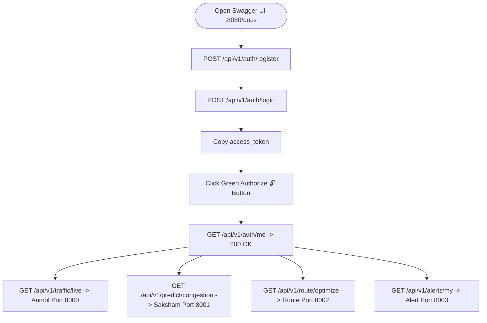

# TrafficVision AI — Interactive FastAPI Swagger Docs Testing Guide (`docs.md`)

Welcome! This guide is written for **beginners** to explain step-by-step how to test the complete **TrafficVision AI Backend & API Gateway** using the interactive **FastAPI Swagger UI Documentation** in your web browser.

It covers how to register, log in, use JWT authentication, test Role-Based Access Control (RBAC), and interact with **Anmol's Data Engineering API**, **Saksham's AI/ML Prediction Engine**, and **Aibin's Route Analysis Microservice** through the API Gateway.

--- 

## 📑 Table of Contents

1. [What is Swagger UI / FastAPI Docs?](#1-what-is-swagger-ui--fastapi-docs)
2. [How to Start the Servers & Open Swagger Docs](#2-how-to-start-the-servers--open-swagger-docs)
3. [Step-by-Step API Testing Walkthrough](#3-step-by-step-api-testing-walkthrough)
   - [Step 1: Register a New User (`POST /api/v1/auth/register`)](#step-1-register-a-new-user-post-apiv1authregister)
   - [Step 2: Login and Get JWT Tokens (`POST /api/v1/auth/login`)](#step-2-login-and-get-jwt-tokens-post-apiv1authlogin)
   - [Step 3: Authorize Swagger UI with the Green Lock Button 🔓](#step-3-authorize-swagger-ui-with-the-green-lock-button-)
   - [Step 4: View Your Profile (`GET /api/v1/auth/me`)](#step-4-view-your-profile-get-apiv1authme)
   - [Step 5: Test Role-Based Access Control (RBAC)](#step-5-test-role-based-access-control-rbac)
   - [Step 6: Test Anmol's Traffic Monitoring APIs (`/api/v1/traffic/*`)](#step-6-test-anmols-traffic-monitoring-apis-apiv1traffic)
   - [Step 7: Test Saksham's AI/ML Prediction APIs (`/api/v1/predict/*`)](#step-7-test-sakshams-aiml-prediction-apis-apiv1predict)
   - [Step 8: Test Route Analysis & Optimization APIs (`/api/v1/route/*`)](#step-8-test-route-analysis--optimization-apis-apiv1route)
   - [Step 9: Test Alerts & Notifications APIs (`/api/v1/alerts/*`)](#step-9-test-alerts--notifications-apis-apiv1alerts)
   - [Step 10: Test Analytics APIs (`/api/v1/analytics/*`)](#step-10-test-analytics-apis-apiv1analytics)
   - [Step 11: Refresh Expired Access Tokens (`POST /api/v1/auth/refresh`)](#step-11-refresh-expired-access-tokens-post-apiv1authrefresh)
4. [Pre-configured Demo Accounts](#4-pre-configured-demo-accounts)
5. [Understanding HTTP Status Codes](#5-understanding-http-status-codes)
6. [Visual Testing Flowchart](#6-visual-testing-flowchart)

---

## 💡 1. What is Swagger UI / FastAPI Docs?

FastAPI automatically generates an interactive visual web page for testing all backend routes:
- **No Postman or curl needed**: Everything can be tested directly in your browser.
- Each box represents an **Endpoint** (an API URL).
- Click on any endpoint box to expand it.
- Click **"Try it out"** to unlock the input fields.
- Click **"Execute"** to send the request to your running Python backend.

---

## 🚀 2. How to Start the Servers (Step-by-Step for Beginners)

To test the **entire system**, you need to run **5 microservices** at the same time. You will need to open **5 separate terminal tabs** in VS Code.

### Terminal 1: Start Anmol's Data Service (Port 8000)
1. Open a new terminal.
2. Run this command:
   ```powershell
   cd "c:\Users\AIBIN SHIBU\OneDrive\Documents\trafficvision\anmol-data"
   ..\aibin-backend\.venv\Scripts\python.exe -m uvicorn Api.traffic_api:app --port 8000 --reload
   ```

### Terminal 2: Start Saksham's AI Engine (Port 8001)
1. Open a **second** terminal tab.
2. Run this command:
   ```powershell
   cd "c:\Users\AIBIN SHIBU\OneDrive\Documents\trafficvision\saksham-aiml"
   ..\aibin-backend\.venv\Scripts\python.exe -m uvicorn ai_engine.main:app --port 8001 --reload
   ```

### Terminal 3: Start Route Analysis Service (Port 8002)
1. Open a **third** terminal tab.
2. Run this command:
   ```powershell
   cd "c:\Users\AIBIN SHIBU\OneDrive\Documents\trafficvision\aibin-backend"
   .\.venv\Scripts\python.exe -m uvicorn route_analysis.main:app --port 8002 --reload
   ```

### Terminal 4: Start Alert Service (Port 8003)
1. Open a **fourth** terminal tab.
2. Run this command:
   ```powershell
   cd "c:\Users\AIBIN SHIBU\OneDrive\Documents\trafficvision\aibin-backend"
   .\.venv\Scripts\python.exe -m uvicorn alert_service.main:app --port 8003 --reload
   ```

### Terminal 5: Start API Gateway (Port 8080)
This is the **Main Gateway** that connects all the services together.
1. Open a **fifth** terminal tab.
2. Run this command:
   ```powershell
   cd "c:\Users\AIBIN SHIBU\OneDrive\Documents\trafficvision\aibin-backend"
   .\.venv\Scripts\python.exe -m uvicorn app.main:app --port 8080 --reload
   ```

### Open the Interactive Swagger Docs in Browser:
👉 **[http://127.0.0.1:8080/docs](http://127.0.0.1:8080/docs)**

---

### 🛠️ Troubleshooting Common Server Errors

If you encounter issues while testing, check these common problems first:

#### 1. I am getting a `502 Bad Gateway` Error!
**What it means:** The Main API Gateway (Terminal 5) is running, but it cannot reach the specific microservice it is trying to talk to.
**How to fix it:** 
- Check the other 4 terminals! A `502` means that Terminal 1, 2, 3, or 4 has either crashed, was closed, or was never started. 
- You must have **all 5 terminals running simultaneously** for the entire system to work. If one crashes, restart that specific terminal.

#### 2. The Swagger UI isn't updating my code changes! (Zombie Processes)
**What it means:** Sometimes Windows holds onto old cached code in the background, especially if you have been restarting the `--reload` command repeatedly over many hours. 
**How to fix it:**
- Stop the Gateway in Terminal 5 by pressing `CTRL+C`.
- Run the command **without** the `--reload` flag one time to break the cache:
  ```powershell
  .\.venv\Scripts\python.exe -m uvicorn app.main:app --port 8080
  ```
- Refresh your browser. Once it works, you can go back to using `--reload`.
- If it is *still* stuck, you may have "zombie" processes. Close all VSCode terminals completely and open fresh ones.

---

## 🧪 3. Step-by-Step API Testing Walkthrough

---

### Step 1: Login and Get JWT Tokens (`POST /api/v1/auth/login`)

**Beginner Note:** You MUST be logged in to test the APIs. You can either register a new account (see Step 1.5 below) OR simply use the built-in admin account right away!

1. Scroll to the **`auth`** section and click on **`POST /api/v1/auth/login`**.
2. Click **"Try it out"**.
3. In the **Request body**, enter the pre-configured Admin login:
   ```json
   {
     "email": "admin@trafficvision.ai",
     "password": "Admin@12345"
   }
   ```
4. Click **"Execute"**.
5. Scroll down to the **Response body**. If successful (`200 OK`), you will see:
   ```json
   {
     "access_token": "eyJhbGciOiJIUzI1NiIsInR5cCI6IkpXVCJ9...",
     "refresh_token": "eyJhbGciOiJIUzI1NiIsInR5cCI6IkpXVCJ9...",
     "token_type": "bearer",
     "role": "admin"
   }
   ```
6. **Copy ONLY the long string of text next to `"access_token"`** (do not copy the quotation marks). This token is your temporary VIP pass to access the system!

---

### Step 1.5 (Optional): Test Registering a New User (`POST /api/v1/auth/register`)

If you want to test creating a brand-new user instead of using the Admin account:
1. Click on **`POST /api/v1/auth/register`** -> **"Try it out"**.
2. Paste the following JSON:
   ```json
   {
     "name": "Your Name",
     "email": "my_new_email@trafficvision.ai",
     "password": "Password123!",
     "role": "admin"
   }
   ```
3. Click **"Execute"**. 
4. **IMPORTANT BEGINNER RULE:** You can only register an email address **ONCE**. If you run this again, it will fail with `400 Bad Request: Email already registered`. If that happens, simply change the email in the JSON box or move on to Step 2 to Login with the email you already created!

---

### Step 2: Authorize Swagger UI with the Green Lock Button 🔓

Now that you have your `access_token`, you need to tell Swagger to use it for all future requests:

1. Scroll to the very top right of the Swagger page and click the green **"Authorize" 🔓** button.
2. In the **Value** box, **paste your `access_token`**. 
   *(Do NOT type the word "Bearer". Just paste the token exactly as you copied it).*
3. Click **"Authorize"**, then click **"Close"**.  
   *The lock icon will change to a locked padlock 🔒. All protected requests will now include your VIP pass automatically!*

---

### Step 4: View Your Profile (`GET /api/v1/auth/me`)

1. Click on **`GET /api/v1/auth/me`**.
2. Click **"Try it out"** -> **"Execute"**.
3. **Response (`200 OK`):**
   ```json
   {
     "user_id": "a1b2c3d4-e5f6-7890-abcd-ef1234567890",
     "name": "Aibin Shibu",
     "email": "aibin@trafficvision.ai",
     "role": "admin"
   }
   ```

---

### Step 5: Test Role-Based Access Control (RBAC)

1. Register a commuter account with `"role": "commuter"`.
2. Login and copy the commuter's `access_token`.
3. Re-authorize Swagger with the commuter token.
4. Try calling an operator-only endpoint (such as `/api/v1/traffic/road/1`).
5. **Response (`403 Forbidden`):**
   ```json
   {
     "detail": "Operation not permitted. Required roles: ['admin', 'traffic_operator']"
   }
   ```

---

### Step 6: Test Anmol's Traffic Monitoring APIs (`/api/v1/traffic/*`)

The Gateway forwards these requests to **Anmol's Data Service** on Port 8000. 

> [!NOTE]
> **Performance Notice:** Anmol's Data Service currently attempts to connect to a Redis cache server that is not running on this system. On Windows, this causes a ~15-20 second delay on the **first request** as it waits for the connection to time out. The Gateway has been configured to wait for this delay, so requests will succeed, but they will be slow initially.

#### 1. Live Traffic (`GET /api/v1/traffic/live`)
- **Execute**: Returns the latest sensor vehicle counts, densities, and congestion levels.

#### 2. Specific Road Traffic (`GET /api/v1/traffic/road/1`)
- **Execute**: Returns traffic readings for Road ID `1`.

#### 3. Overall Density Summary (`GET /api/v1/traffic/density`)
- **Execute**: Returns density across all corridors.

---

### Step 6.1: Test Analytics Endpoints (`/api/v1/analytics/*`)

The Gateway also proxies traffic analytics from Anmol's Data Service:

#### 1. Traffic Trends (`GET /api/v1/analytics/trends`)
- **Execute**: Returns daily or weekly traffic congestion patterns per road.
- **Parameters**: `range=day` or `range=week`.

#### 2. Incident Heatmap (`GET /api/v1/analytics/heatmap`)
- **Execute**: Returns congestion heatmap grid data across roads and time buckets.

#### 3. Historical Reports (`GET /api/v1/analytics/reports`)
- **Execute**: Generates a historical traffic report.
- **Parameters**: By default returns a `json` preview. Set `format=csv` to download a full CSV report.

#### 4. Historical Trends (`GET /api/v1/traffic/history/1`)
- **Execute**: Returns time-series history for Road ID `1`.

#### 5. Road Conditions (`GET /api/v1/traffic/conditions/1`)
- **Execute**: Returns active incidents, construction, or road closure status.

---

### Step 7: Test Saksham's AI/ML Prediction APIs (`/api/v1/predict/*`)

The Gateway forwards these requests to **Saksham's AI Engine** on Port 8001:

#### 1. Congestion Classification (`GET /api/v1/predict/congestion`)
- **Parameters**: `road_id = 1`, `density = 0.75`, `vehicle_count = 80`
- **Execute (`200 OK`)**:
  ```json
  {
    "road_id": "1",
    "predicted_level": "HIGH",
    "confidence": 0.6625,
    "model_version": "model-v1",
    "timestamp": "2026-09-24T18:46:21.085902",
    "data_source": "trained-random-forest"
  }
  ```

#### 2. Travel Delay Estimation (`GET /api/v1/predict/delay`)
- **Parameters**: `road_id = 1`, `density = 0.65`, `vehicle_count = 60`
- **Execute (`200 OK`)**:
  ```json
  {
    "road_id": "1",
    "estimated_delay_minutes": 24.0,
    "is_rush_hour": true,
    "confidence": 0.7766,
    "model_version": "model-v1",
    "timestamp": "2026-09-24T18:46:45.095328"
  }
  ```

#### 3. Peak-Hour Status (`GET /api/v1/predict/peak-hours`)
- **Parameters**: `hour = 9` (or `hour = 14`)
- **Execute (`200 OK`)**:
  ```json
  {
    "hour": 9,
    "is_peak": true,
    "description": "Morning/Evening rush hour"
  }
  ```

#### 4. Multi-Route Candidate Ranking (`POST /api/v1/predict/routes/rank`)
- **Request body**:
  ```json
  {
    "timestamp": "2026-09-17T09:00:00",
    "candidate_routes": [
      {
        "route_id": "route_highway",
        "segments": [
          { "road_id": "1", "base_duration_min": 10.0, "density": 0.85, "vehicle_count": 120 }
        ]
      },
      {
        "route_id": "route_bypass",
        "segments": [
          { "road_id": "2", "base_duration_min": 12.0, "density": 0.20, "vehicle_count": 25 }
        ]
      }
    ]
  }
  ```
- **Execute (`200 OK`)**:
  ```json
  {
    "status": "success",
    "timestamp": "2026-09-17T09:00:00",
    "total_routes_evaluated": 2,
    "ranked_routes": [
      {
        "route_id": "route_bypass",
        "total_effective_eta_min": 27.3,
        "base_duration_min": 12.0,
        "total_predicted_delay_min": 15.3,
        "worst_segment_congestion": "LOW",
        "segments_count": 1,
        "segment_breakdown": [
          {
            "road_id": "2",
            "base_duration_min": 12.0,
            "predicted_congestion": "LOW",
            "predicted_delay_min": 15.3
          }
        ],
        "rank": 1,
        "is_recommended": true
      },
      {
        "route_id": "route_highway",
        "total_effective_eta_min": 38.5,
        "base_duration_min": 10.0,
        "total_predicted_delay_min": 28.5,
        "worst_segment_congestion": "SEVERE",
        "segments_count": 1,
        "segment_breakdown": [
          {
            "road_id": "1",
            "base_duration_min": 10.0,
            "predicted_congestion": "SEVERE",
            "predicted_delay_min": 28.5
          }
        ],
        "rank": 2,
        "is_recommended": false
      }
    ]
  }
  ```

#### 5. AI Anomaly Detection (`GET /api/v1/predict/anomalies`)
- **Parameters**: `road_id = 1`, `expected_level = LOW`, `observed_level = SEVERE`
- **Execute (`200 OK`)**:
  ```json
  {
    "road_id": "1",
    "time": "2026-10-01T13:00:00.000000",
    "expected_level": "LOW",
    "observed_level": "SEVERE",
    "flagged_as": "possible_incident"
  }
  ```

#### 6. AI Recommendations (`GET /api/v1/predict/recommendations`)
- **Parameters**: `road_id = 1`, `density = 0.85`, `vehicle_count = 100`
- **Execute (`200 OK`)**:
  ```json
  {
    "road_id": "1",
    "recommendation_text": "Divert traffic immediately.",
    "based_on": "HIGH congestion with 28.5 minutes delay"
  }
  ```

---

### Step 8: Test Route Analysis & Optimization APIs (`/api/v1/route/*`)

The Gateway forwards these requests to the **Route Analysis Microservice** on Port 8002:

#### 1. Optimal Driving Route (`GET /api/v1/route/optimize`)
- **Parameters**: `origin = 12.9716,77.5946`, `destination = 12.9352,77.6245`
- **Execute (`200 OK`)**: 
  ```json
  {
    "route_id": "rt_opt_129716_775946_to_129352_776245",
    "path": [[12.971848, 77.594697], [12.971871, 77.59464], "..."],
    "distance_km": 7.5,
    "congestion_score": 0.45,
    "summary": "Via OpenStreetMap Highway"
  }
  ```

#### 2. Alternative Candidate Routes (`GET /api/v1/route/alternate`)
- **Parameters**: `origin = 12.9716,77.5946`, `destination = 12.9352,77.6245`, `max_routes = 3`
- **Execute (`200 OK`)**: 
  ```json
  [
    {
      "route_id": "rt_opt_129716_775946_to_129352_776245",
      "path": [[12.971848, 77.594697], "..."],
      "distance_km": 8.69,
      "congestion_score": 0.15,
      "rank": 1
    },
    {
      "route_id": "rt_alt_1_129716_775946_to_129352_776245",
      "name": "Alternate Corridor 1",
      "path": [[12.971848, 77.594697], "..."],
      "distance_km": 7.5,
      "congestion_score": 0.75,
      "rank": 2
    }
  ]
  ```

#### 3. Travel Time & ETA (`GET /api/v1/route/travel-time`)
- **Parameters**: `route_id = rt_opt_129716_775946_to_129352_776245`
- **Execute (`200 OK`)**: 
  ```json
  {
    "route_id": "rt_opt_129716_775946_to_129352_776245",
    "estimated_minutes": 34.9,
    "based_on": "live+predicted",
    "baseline_minutes": 12.9,
    "congestion_delay_minutes": 22.0
  }
  ```

#### 4. Live Corridor Conditions (`GET /api/v1/route/conditions`)
- **Parameters**: `road_id = 1`
- **Execute (`200 OK`)**:
  ```json
  {
    "road_id": "1",
    "status": "NORMAL",
    "notes": "Road open. Telemetry operating in baseline mode.",
    "current_density": null,
    "average_speed_kmh": null
  }
  ```

---

### Step 9: Test Alerts & Notifications APIs (`/api/v1/alerts/*`)

The Gateway forwards these requests to the **Alert Service** on Port 8003:

#### 1. View My Alerts (`GET /api/v1/alerts/my`)
- **Execute (`200 OK`)**: Returns a list of alerts visible to the authenticated user.
- **Note**: Role-based access determines visibility (e.g., commuters see less than operators).

#### 2. View Active Dashboard Alerts (`GET /api/v1/alerts/active`)
- **Execute (`200 OK`)**: Returns all unread/active alerts for Admin/Operator dashboards.
- **Note**: If you test this with a commuter account, you will receive a `403 Forbidden` error.

#### 3. Mark Alert as Read (`POST /api/v1/alerts/{alert_id}/read`)
- **Parameters**: `alert_id = 1`
- **Execute (`200 OK`)**: Marks a specific alert as read.

#### 4. Create Alert Manually (`POST /api/v1/alerts`)
- **Request body**:
  ```json
  {
    "type": "congestion",
    "severity": "high",
    "road_id": "1",
    "message": "Manual test alert from Swagger UI"
  }
  ```
- **Execute (`200 OK`)**:
  ```json
  {
    "alert_id": 1
  }
  ```

### Step 11: Refresh Expired Access Tokens (`POST /api/v1/auth/refresh`)

When your 30-minute access token expires:
1. Click **`POST /api/v1/auth/refresh`**.
2. Pass the `refresh_token` received during login.
3. Receive a new valid `access_token` without re-entering credentials!

---

## 👥 4. Pre-configured Demo Accounts

| Email | Password | Role | Permissions |
|---|---|---|---|
| `admin@trafficvision.ai` | `Admin@12345` | `admin` | Full system access, all routes & proxies |
| `operator@trafficvision.ai` | `Operator@123` | `traffic_operator` | Traffic sensors, incident reporting |
| `planner@trafficvision.ai` | `Planner@123` | `city_planner` | Long-term analytics & density trends |
| `commuter@trafficvision.ai` | `Commuter@123` | `commuter` | Routes, predictions, conditions |

---

## 📋 5. Understanding HTTP Status Codes

| Code | Status | Meaning |
|---|---|---|
| `200` | **OK** | Request succeeded and returned data. |
| `201` | **Created** | New user or resource was successfully registered. |
| `400` | **Bad Request** | Malformed input, duplicate email, or invalid coordinates. |
| `401` | **Unauthorized** | Missing or invalid JWT access token. |
| `403` | **Forbidden** | Valid token, but your user role lacks permission for this endpoint. |
| `404` | **Not Found** | The requested resource or route ID does not exist. |
| `422` | **Unprocessable Entity** | Pydantic validation error (e.g. string passed instead of float). |
| `500` | **Internal Error** | Unhandled server exception. |

---

## 📊 6. Visual Testing Flowchart



---
*Authored by Intern 1 (Team Lead / Backend & Integration) — TrafficVision AI Team*
*Last verified against live /openapi.json on: 2026-09-24*
