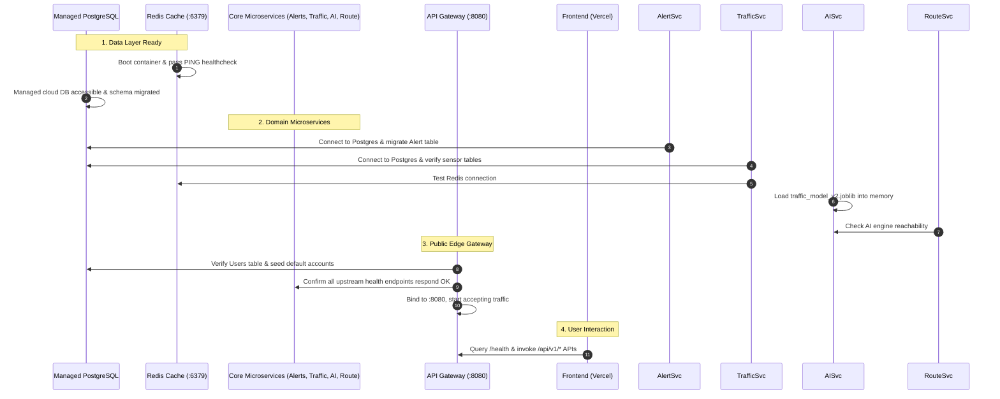

# TrafficVision AI — Milestone 4 Deployment Plan
**Author:** Intern 1 (Team Lead / Backend & Integration)  
**Project:** TrafficVision AI — Smart Traffic Prediction & Congestion Management System  
**Milestone:** Milestone 4 (Testing, Deployment & Documentation)  
**Status:** Approved Architecture Plan  

---

## 1. Executive Summary

Milestones 1–3 established the comprehensive functionality of TrafficVision AI locally. Milestone 4 represents the critical leap to a live production environment on a free-tier cloud platform. In accordance with milestone guidelines, **all API contracts from M1–M3 remain strictly frozen**. Milestone 4 establishes reliable container orchestration, hardened API Gateway policies, shared environment contracts, continuous deployment pipelines, and thorough end-to-end verification.

---

## 2. Deployment Architecture

### 2.1 Architecture Topology (Mermaid Diagram)

```mermaid
graph TD
    subgraph Public Internet
        Browser["End Users / Commuters / Operators"]
        Frontend["Intern 4: Frontend App\n(Next.js 15 / React 19)\nHosted on Vercel / Cloud"]
    end

    subgraph Cloud Infrastructure (Free-Tier VM / Host)
        subgraph Reverse Proxy & Gateway
            Gateway["Intern 1: API Gateway & Auth\n(FastAPI :8080)\n- SSL / TLS Termination\n- Strict CORS & Security Headers\n- Rate Limiting\n- JWT & RBAC Verification"]
        end

        subgraph Private Internal Docker Network [trafficvision-net]
            RouteSvc["Intern 1: Route Analysis Service\n(FastAPI :8002)\n- OSRM / OSM Client"]
            AlertSvc["Intern 1: Alert Microservice\n(FastAPI :8003)\n- Incident / Anomaly Alerts"]
            TrafficSvc["Intern 2: Traffic & Analytics Service\n(FastAPI :8000)\n- Live Readings & History"]
            AISvc["Intern 3: AI/ML Inference Engine\n(FastAPI :8001)\n- Joblib Model v2"]
            RedisCache["Redis Cache (:6379)\n- Live traffic cache\n- Rate limit storage"]
        end
    end

    subgraph Managed Cloud Data Layer (Free Tier)
        ManagedDB["Managed PostgreSQL Database\n(Neon / Supabase / Aiven Free Tier :5432)\n- Users & RBAC\n- Alerts Table\n- Traffic Readings & Roads"]
    end

    subgraph External Public APIs
        OSRM["Project OSRM Routing Engine\n(router.project-osrm.org)"]
    end

    Browser -->|HTTPS :443| Frontend
    Frontend -->|HTTPS API Requests| Gateway
    Browser -->|Direct API / Swagger| Gateway

    Gateway -->|Internal HTTP| RouteSvc
    Gateway -->|Internal HTTP| AlertSvc
    Gateway -->|Internal HTTP| TrafficSvc
    Gateway -->|Internal HTTP| AISvc
    Gateway -->|Redis Commands| RedisCache

    RouteSvc -->|OSRM Queries| OSRM
    RouteSvc -->|Route Candidate Scoring| AISvc

    AISvc -->|Anomaly Trigger POST| AlertSvc

    TrafficSvc -->|Read / Write SQL| ManagedDB
    TrafficSvc -->|Cache Live Stream| RedisCache

    AlertSvc -->|Read / Write SQL| ManagedDB
    Gateway -->|Auth SQL Queries| ManagedDB
```

---

## 3. Cloud Target Evaluation & Recommendation

We evaluated the three most prevalent options for deploying multi-service container stacks on free tiers:

| Evaluation Criteria | Render Free Tier | Railway Free Trial | Free-Tier Cloud VM (Oracle Cloud Always Free / AWS EC2 t4g.small / Azure B1s) + Docker Compose |
| :--- | :--- | :--- | :--- |
| **Service Limit** | Free tier allows web services, but spins down after 15 min of inactivity (cold starts 50s+); limits concurrency. | 30-day $5 credit limit; requires card and expires after trial period. | **Continuous 24/7 uptime**; no idle spin-down. |
| **RAM / CPU Capacity** | 512 MB per service (running 5 backend services consumes 5 separate service quotas). | Shared 512 MB - 1 GB credit budget. | **1 GB to 24 GB RAM** (Oracle ARM provides up to 24 GB; AWS/Azure provides 1 GB - 2 GB). |
| **Multi-Service Networking**| Complex cross-service private routing setup on free tier. | Private networking works but burns monthly credit quickly. | **Native Docker Compose bridge network** (`trafficvision-net`), allowing seamless DNS resolution (`http://ai-engine:8001`, `http://route-analysis:8002`). |
| **Cost & Longevity** | Free with severe sleep/spin-down penalties. | Paid after initial trial expires. | **100% Free indefinitely** under cloud free tier allowances. |

### Recommendation: Free-Tier VM with Production Docker Compose (+ External Managed PostgreSQL)
* **Chosen Solution:** A cloud VM instance running Linux (Ubuntu 22.04 LTS / 24.04 LTS) with Docker & Docker Compose v2, paired with a free-tier managed PostgreSQL instance (Neon, Supabase, or Aiven) and Next.js frontend deployed on Vercel.
* **Why this wins:**
  1. **Zero Cold Starts:** Microservices stay warm in memory, ensuring fast API responses for demos and testing.
  2. **Single Ingress Point:** The API Gateway on port `8080` (or reverse proxied via Nginx/Caddy on `80/443`) exposes only one port to the public internet, keeping microservices securely behind an internal Docker bridge network.
  3. **High Fidelity:** The production Docker Compose setup mirrors local development while enforcing strict production resource limits and health dependencies.

---

## 4. Per-Service Deployment Responsibilities (All 5 Interns)

| Intern | Role | Deployment Deliverable & Scope |
| :--- | :--- | :--- |
| **Intern 1 (Me - Team Lead)** | Backend & Integration | - API Gateway (`:8080`) production configuration, strict CORS, rate limiting, and security headers.<br>- Route Analysis (`:8002`) and Alert Service (`:8003`) production containerization.<br>- Unified `docker-compose.prod.yml`, `.env.production.example`, and `ENV_VARS.md`.<br>- Validation scripts (`smoke-test.sh`, `validate-workflows.py`). |
| **Intern 2** | Data & Database | - Schema migration execution (`Database/schema.sql`) against the production managed PostgreSQL instance.<br>- Traffic Monitoring & Analytics API (`:8000`) containerization and database connection validation.<br>- Providing production database connection string (`DATABASE_URL`). |
| **Intern 3** | AI/ML & Intelligent Routing | - Packaging `ai_engine` with `traffic_model_v2.joblib` artifact into container image (`:8001`).<br>- Ensuring model artifact loads within 512 MB memory threshold.<br>- Updating alert callback URL to read `ALERT_SERVICE_URL` from env (per `INTEGRATION_NOTES.md`). |
| **Intern 4** | Frontend Application | - Deploying Next.js 15 application to Vercel (or static export).<br>- Setting `NEXT_PUBLIC_API_URL` to point to the production Gateway URL.<br>- Providing frontend domain (e.g. `https://trafficvision.vercel.app`) to Intern 1 for CORS allow-listing. |
| **Intern 5** | DevOps & CI/CD | - GitHub Actions CI/CD workflow configuration (`.github/workflows/deploy.yml`).<br>- Configuring GitHub Secrets (`DOCKER_USERNAME`, `DOCKER_PASSWORD`, `PROD_SERVER_IP`, `SSH_PRIVATE_KEY`, `DATABASE_URL`).<br>- Managing automated deploy triggers upon push to `main` branch. |

---

## 5. Startup Order & Health Check Strategy

Because microservices rely on shared databases, caches, and downstream services, services must start in a deterministic order using Docker Compose `depends_on` conditions.



### Health Check Definitions:
1. **Redis**: `redis-cli ping` (interval: 10s, timeout: 3s, retries: 3).
2. **Alert Service (`:8003`)**: `curl -f http://localhost:8003/health` (interval: 15s, timeout: 5s, retries: 3).
3. **Route Analysis (`:8002`)**: `curl -f http://localhost:8002/health` (interval: 15s, timeout: 5s, retries: 3).
4. **Traffic Monitoring (`:8000`)**: `curl -f http://localhost:8000/` (interval: 15s, timeout: 5s, retries: 3).
5. **AI Inference (`:8001`)**: `python -c "import urllib.request; urllib.request.urlopen('http://localhost:8001/predict/peak-hours?hour=12')"` or dedicated `/health` (interval: 20s, timeout: 5s, retries: 3).
6. **API Gateway (`:8080`)**: `curl -f http://localhost:8080/health` (interval: 15s, timeout: 5s, retries: 3).

---

## 6. Risks & Mitigation Matrix

| Risk Identified | Severity | Probability | Concrete Mitigation |
| :--- | :--- | :--- | :--- |
| **Free-Tier Memory Exhaustion (OOM)** | High | Medium | 1. Implement Docker resource limits (`mem_limit: 384m` on Python services, `mem_limit: 128m` on Redis).<br>2. Enable 2 GB swap space on Linux VM.<br>3. Turn off unneeded background watchers. |
| **CORS Failure on Frontend** | High | Low | Read `CORS_ALLOWED_ORIGINS` from environment variable. Support comma-delimited strings to allow localhost and production frontend domains without code modifications. |
| **Upstream Service Timeout / Hang** | Medium | Medium | Configure strict request timeouts in Gateway `httpx.AsyncClient` (3s–5s). Wrap upstream calls in `try/except` returning clean `502 Bad Gateway` and `504 Gateway Timeout` JSON error payloads. |
| **Database Connection Pool Exhaustion** | High | Low | Limit SQLAlchemy connection pool size to `pool_size=5, max_overflow=5` across services to prevent hitting free-tier Postgres connection limits (typically 20 max connections on Neon/Supabase). |
| **OSRM Public API Rate Limiting** | Low | Low | Implement retry backoff and caching of static corridor distances in Route Analysis microservice. |
| **Secret Leakage in Git** | Critical | Low | Strictly exclude `.env`, `.env.production`, and credential files in `.gitignore`. Distribute only `.env.production.example` with sanitized placeholders. |
