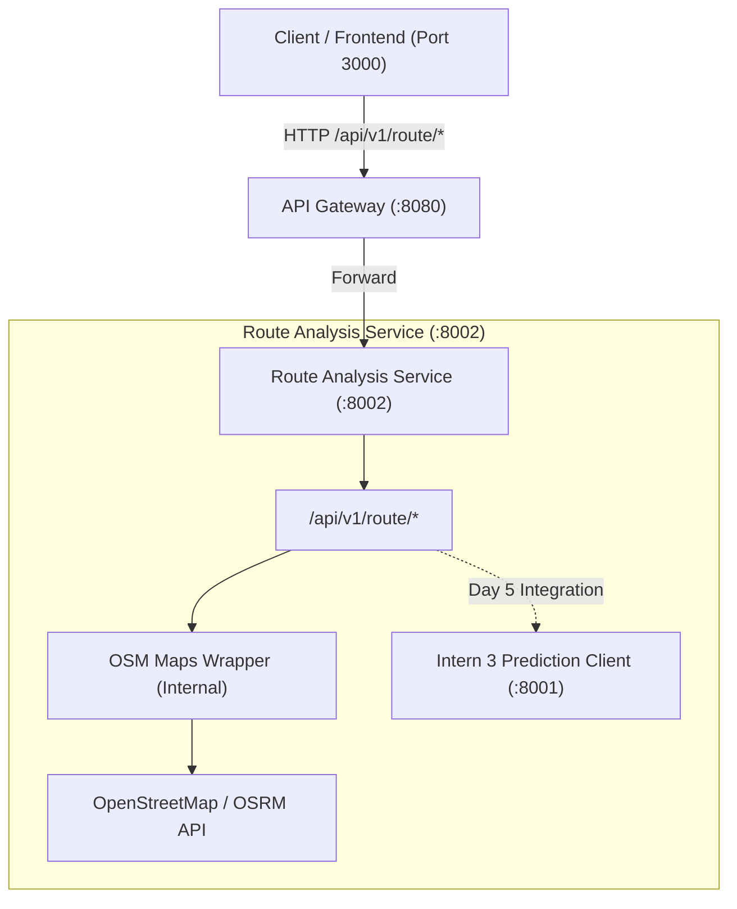

# Route Analysis Service — Frozen API Contract Specification (`route-analysis-contract.md`)

**Service Owner**: Intern 1 (Team Lead / Backend & Integration)  
**Service Name**: Route Analysis Microservice (`route-analysis-service`)  
**Milestone**: Milestone 2 (Traffic Prediction & Route Optimization)  
**Contract Version**: `v1.0.0` (Freezes Day 2 EOD)  
**Default Port**: `8002` (Gateway proxy mount: `/api/v1/route/*` on Port `8080`)  
**Provider**: OpenStreetMap (OSRM / Free, Open-Source & Keyless)  

---

## 📑 Table of Contents

1. [Architecture & Design Principles](#1-architecture--design-principles)
2. [Coordinate Format & Input Validation Standard](#2-coordinate-format--input-validation-standard)
3. [API Endpoints Specification](#3-api-endpoints-specification)
   - [3.1 `GET /api/v1/route/optimize`](#31-get-apiv1routeoptimize)
   - [3.2 `GET /api/v1/route/alternate`](#32-get-apiv1routealternate)
   - [3.3 `GET /api/v1/route/travel-time` (Day 4–5 Spec)](#33-get-apiv1routetravel-time-day-45-spec)
   - [3.4 `GET /api/v1/route/conditions` (Day 4–5 Spec)](#34-get-apiv1routeconditions-day-45-spec)
4. [Standard Error Responses](#4-standard-error-responses)
5. [Teammate Contract Cross-Reference & Mismatch Flags](#5-teammate-contract-cross-reference--mismatch-flags)

---

## 🏛️ 1. Architecture & Design Principles

The Route Analysis Service is responsible for:
- Computing geographic road paths and distances between GPS coordinates (`origin` and `destination`) using free, keyless OpenStreetMap infrastructure.
- In Milestone 2 Day 1–3, delivering the optimal path and alternate candidates with placeholder congestion metrics.
- In Milestone 2 Day 4–5, integrating with Intern 3's real AI/ML Prediction Service (`/api/v1/predict/congestion`) to calculate live congestion penalties, ranked corridors, and estimated travel times.



---

## 📍 2. Coordinate Format & Input Validation Standard

All route calculation endpoints expect geographic coordinates passed as comma-separated `lat,lng` decimal strings:
- **Format**: `"{latitude},{longitude}"` (e.g., `"12.9716,77.5946"`)
- **Latitude Constraints**: `-90.000000` to `+90.000000`
- **Longitude Constraints**: `-180.000000` to `+180.000000`
- **Validation Failure**: Returns `400 Bad Request` with an explicit error description detailing which coordinate failed validation.

---

## 🚀 3. API Endpoints Specification

---

### 3.1 `GET /api/v1/route/optimize`

Computes the primary optimal driving route between origin and destination coordinates.

* **Method**: `GET`
* **Path**: `/api/v1/route/optimize`
* **Query Parameters**:
  | Parameter | Type | Required | Default | Description | Example |
  | :--- | :--- | :--- | :--- | :--- | :--- |
  | `origin` | String | **Yes** | — | Origin coordinate `lat,lng` | `12.9716,77.5946` |
  | `destination` | String | **Yes** | — | Destination coordinate `lat,lng` | `12.9352,77.6245` |
  | `preference` | String | No | `fastest` | Routing preference (`fastest`, `shortest`, `least_congested`) | `fastest` |

* **Success Response (`200 OK`)**:
```json
{
  "route_id": "rt_opt_129716_775946_to_129352_776245",
  "path": [
    [12.9716, 77.5946],
    [12.9645, 77.6012],
    [12.9510, 77.6130],
    [12.9352, 77.6245]
  ],
  "distance_km": 5.42,
  "congestion_score": 0.0,
  "summary": "Via Outer Ring Rd / Koramangala 80ft Rd"
}
```

* **Field Definitions**:
  - `route_id` (String): Unique identifier generated for the calculated route.
  - `path` (Array of `[float, float]`): Ordered sequence of `[latitude, longitude]` GPS waypoints representing the road path polyline.
  - `distance_km` (Float): Total driving distance along the road network in kilometers.
  - `congestion_score` (Float, `0.0`–`1.0`): Congestion score along the path. *(Note: Defaulted to 0.0 placeholder during Day 1–3; dynamically computed via AI Prediction Service on Day 5).*
  - `summary` (String, Optional): Primary road or corridor names utilized.

---

### 3.2 `GET /api/v1/route/alternate`

Returns 2 to 3 alternative candidate routes between origin and destination, ranked for comparison.

* **Method**: `GET`
* **Path**: `/api/v1/route/alternate`
* **Query Parameters**:
  | Parameter | Type | Required | Default | Description | Example |
  | :--- | :--- | :--- | :--- | :--- | :--- |
  | `origin` | String | **Yes** | — | Origin coordinate `lat,lng` | `12.9716,77.5946` |
  | `destination` | String | **Yes** | — | Destination coordinate `lat,lng` | `12.9352,77.6245` |
  | `max_routes` | Integer | No | `3` | Maximum candidates to return (2–5) | `3` |

* **Success Response (`200 OK`)**:
```json
[
  {
    "route_id": "rt_cand_1_129716_775946_to_129352_776245",
    "name": "Route 1 (Primary Arterial)",
    "path": [
      [12.9716, 77.5946],
      [12.9645, 77.6012],
      [12.9352, 77.6245]
    ],
    "distance_km": 5.42,
    "congestion_score": 0.0,
    "rank": 1
  },
  {
    "route_id": "rt_cand_2_129716_775946_to_129352_776245",
    "name": "Route 2 (Inner Bypass)",
    "path": [
      [12.9716, 77.5946],
      [12.9580, 77.5850],
      [12.9352, 77.6245]
    ],
    "distance_km": 6.18,
    "congestion_score": 0.0,
    "rank": 2
  }
]
```

* **Field Definitions**:
  - `rank` (Integer): Priority ranking (1 = highest recommendation based on distance in Day 1–3, congestion-weighted on Day 5).

---

### 3.3 `GET /api/v1/route/travel-time` (Day 4–5 Spec)

Estimates duration in minutes for a specific route ID based on baseline free-flow speed and AI predicted congestion penalties.

* **Method**: `GET`
* **Path**: `/api/v1/route/travel-time`
* **Query Parameters**:
  | Parameter | Type | Required | Description | Example |
  | :--- | :--- | :--- | :--- | :--- |
  | `route_id` | String | **Yes** | Calculated Route ID | `rt_opt_129716_775946_to_129352_776245` |
  | `departure_time` | String | No | ISO-8601 timestamp | `2026-09-16T17:30:00Z` |

* **Success Response (`200 OK`)**:
```json
{
  "route_id": "rt_opt_129716_775946_to_129352_776245",
  "estimated_minutes": 18.5,
  "baseline_minutes": 12.0,
  "congestion_delay_minutes": 6.5,
  "based_on": "ai-model-v1 + historical-rush-hour"
}
```

---

### 3.4 `GET /api/v1/route/conditions` (Day 4–5 Spec)

Retrieves real-time condition, active telemetry, and incidents for a specific road corridor.

* **Method**: `GET`
* **Path**: `/api/v1/route/conditions`
* **Query Parameters**:
  | Parameter | Type | Required | Description | Example |
  | :--- | :--- | :--- | :--- | :--- |
  | `road_id` | String | **Yes** | Road or corridor identifier | `1` or `R001` |

* **Success Response (`200 OK`)**:
```json
{
  "road_id": "1",
  "status": "CONGESTED",
  "current_density": 0.78,
  "average_speed_kmh": 18.4,
  "notes": "Heavy traffic detected near MG Road Junction. Expect 6–10 min delay."
}
```

---

## ⚠️ 4. Standard Error Responses

All Route Analysis endpoints return standard structured error JSON:

* **`400 Bad Request`** (Invalid or malformed coordinates):
```json
{
  "detail": "Invalid origin coordinates: 'invalid,coords'. Must be comma-separated decimal latitude and longitude (e.g., '12.9716,77.5946')."
}
```

* **`404 Not Found`** (No path found or route_id does not exist):
```json
{
  "detail": "No driving route found between origin and destination coordinates."
}
```

* **`503 Service Unavailable`** (External OSM / OSRM routing failure without fallback):
```json
{
  "detail": "Routing service temporarily unavailable. Please try again."
}
```

---

## 🚩 5. Teammate Contract Cross-Reference & Mismatch Flags

Inspection of `saksham-aiml/` and `hariom-frontend/` revealed the following observations:

1. **Frontend Request Method & Body Format (`hariom-frontend/frontend/docs/milestone2-plan.md`)**:
   - **Frontend Draft**: Proposed `POST /api/v1/route/optimize` with JSON body `{"origin": "R003", "destination": "R004", "preference": "fastest"}` using discrete road segment IDs.
   - **Backend / SRS Spec**: Specifies `GET /api/v1/route/optimize?origin={lat,lng}&destination={lat,lng}` using continuous GPS coordinates.
   - **Action / Flag**: Flagged for team alignment. The Backend Route Analysis service will implement the GPS coordinate `GET` standard.

2. **Frontend Travel Time Endpoint Name**:
   - **Frontend Draft**: Proposed `GET /api/v1/route/travel?route_id={id}`.
   - **Backend / SRS Spec**: Defines `GET /api/v1/route/travel-time?route_id={id}`.
   - **Action / Flag**: Flagged for Intern 4 to ensure frontend fetches from `/route/travel-time`.

3. **AI Engine Route-Ranking Contract (`saksham-aiml/docs/milestone-2-aiml-plan.md`)**:
   - Intern 3 provides `GET /api/v1/predict/congestion?road_id={id}&time={time}` returning `predicted_level` and `confidence`.
   - On Day 5, the Route Analysis Service will query Intern 3's endpoint per road corridor to score and rank candidate routes.
