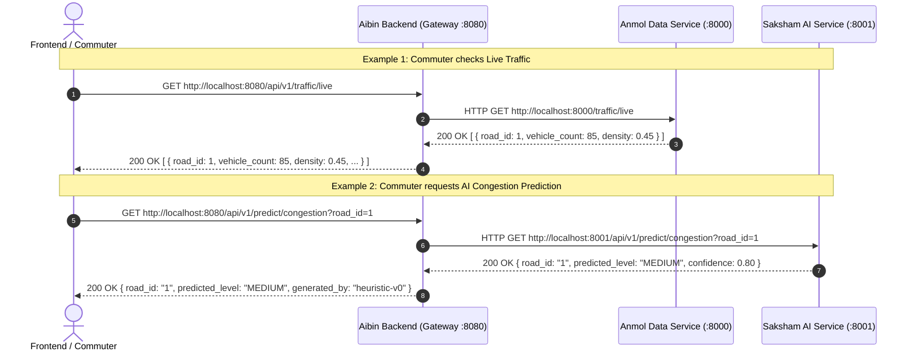
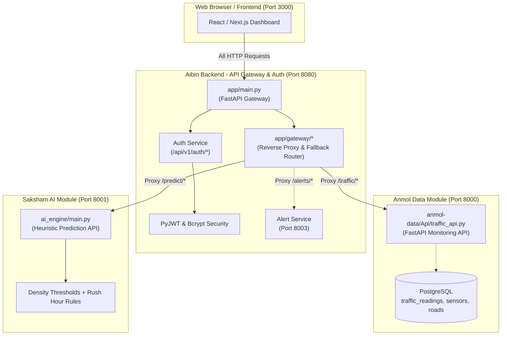

# TrafficVision AI — Multi-Service Integration & Beginner's Guide (`mainreadme.md`)

Welcome! This guide is written specifically for **beginners** to explain how the entire **TrafficVision AI** multi-service system works, how to run **Anmol's Data Monitoring API**, **Saksham's AI Engine API**, and **Aibin's API Gateway & Auth**, how they communicate with each other, and how to verify everything works together.

---

## 📑 Table of Contents

1. [How Does All This Work? (Simple Beginner Explanation)](#1-how-does-all-this-work-simple-beginner-explanation)
   - [The Restaurant Analogy](#the-restaurant-analogy)
   - [What is an API Gateway?](#what-is-an-api-gateway)
   - [What are Ports? (Why 8000, 8001, 8080?)](#what-are-ports-why-8000-8001-8080)
   - [How Requests Flow Across Services](#how-requests-flow-across-services)
2. [Do I Need Another Virtual Environment (`.venv`) for Them?](#2-do-i-need-another-virtual-environment-venv-for-them)
3. [Port Assignment & Service Map](#3-port-assignment--service-map)
4. [Step-by-Step: How to Run All 3 Services](#4-step-by-step-how-to-run-all-3-services)
   - [Terminal 1: Run Anmol's Data Engineering Service (Port 8000)](#terminal-1-run-anmols-data-engineering-service-port-8000)
   - [Terminal 2: Run Saksham's AI Engine Prediction Service (Port 8001)](#terminal-2-run-sakshams-ai-engine-prediction-service-port-8001)
   - [Terminal 3: Run Aibin's Backend API Gateway & Auth (Port 8080)](#terminal-3-run-aibins-backend-api-gateway--auth-port-8080)
5. [After Making Both Live, Do I Need to Edit Anything in `aibin-backend`?](#5-after-making-both-live-do-i-need-to-edit-anything-in-aibin-backend)
6. [How to Test & Verify the Live Integration](#6-how-to-test--verify-the-live-integration)
7. [Visual System Architecture & Integration Diagram](#7-visual-system-architecture--integration-diagram)
8. [Summary Cheat Sheet for Beginners](#8-summary-cheat-sheet-for-beginners)

---

## 1. How Does All This Work? (Simple Beginner Explanation)

If you are new to microservices and backend development, here is how to think about this project in plain English.

### The Restaurant Analogy

Imagine TrafficVision AI is a modern restaurant:

```text
 ┌─────────────────────────────────────────────────────────────┐
 │                      THE RESTAURANT                         │
 │                                                             │
 │  [Customer / Frontend App]                                  │
 │         │                                                   │
 │         ▼ (Orders food / requests traffic data)             │
 │  [Front Desk & Host: Aibin (Intern 1) - Port 8080]          │
 │  • Checks customer ID (JWT Login / Authentication)          │
 │  • Takes all requests at the main counter (API Gateway)     │
 │  • Coordinates with the kitchen staff                       │
 │         │                           │                       │
 │         ▼                           ▼                       │
 │  [Chef Anmol (Intern 2)]     [Chef Saksham (Intern 3)]      │
 │  [Data Kitchen - Port 8000]  [AI Kitchen - Port 8001]       │
 │  • Handles raw ingredients   • Prepares smart recipes       │
 │  • Reads PostgreSQL database • Predicts traffic congestion  │
 │  • Live traffic sensors      • Heuristic rules & ML         │
 └─────────────────────────────────────────────────────────────┘
```

1. **You (Aibin / Intern 1 — `aibin-backend`):** You are the **Front Desk, Host, and Security Guard**. When the frontend user or mobile app connects, they **only talk to you at port 8080**. You check their login ticket (JWT token), ensure they have permission (Admin vs. Operator vs. Public), and know exactly which kitchen chef to ask for information.
2. **Anmol (Intern 2 — `anmol-data`):** Anmol manages the **Traffic Data & Sensors**. He connects to PostgreSQL, reads sensor counts from roads, and computes raw vehicle density. His service runs on **Port 8000**.
3. **Saksham (Intern 3 — `saksham-aiml`):** Saksham manages the **AI Prediction Engine**. He takes traffic density numbers and calculates whether traffic will be `LOW`, `MEDIUM`, `HIGH`, or `SEVERE`. His service runs on **Port 8001**.

---

### What is an API Gateway?

In a microservice system, having the frontend app connect directly to 5 different servers with 5 different URLs and ports would be messy and insecure.

An **API Gateway** solves this by providing **ONE single front door** (`http://127.0.0.1:8080`):
- The frontend only needs to know **one URL**: `http://127.0.0.1:8080`.
- The Gateway automatically forwards requests:
  - When someone asks for `/api/v1/traffic/live`, the Gateway fetches it from Anmol's service (`http://127.0.0.1:8000`).
  - When someone asks for `/api/v1/predict/congestion`, the Gateway fetches it from Saksham's service (`http://127.0.0.1:8001`).
  - When someone registers or logs in (`/api/v1/auth/*`), the Gateway handles it directly.

---

### What are Ports? (Why 8000, 8001, 8080?)

Think of your computer (`127.0.0.1` / `localhost`) as an **apartment building**.
- **The IP Address (`127.0.0.1`)** is the building's street address.
- **The Port Number** is the **apartment door number**:
  - `Door 8000`: Anmol's Traffic Monitoring Service.
  - `Door 8001`: Saksham's AI Engine Prediction Service.
  - `Door 8080`: Aibin's API Gateway & Auth Service.

Because all 3 programs run on your computer at the same time, each program must listen on a **unique port number** so they don't crash into each other.

---

### How Requests Flow Across Services



---

## 2. Do I Need Another Virtual Environment (`.venv`) for Them?

### Short Answer: **NO! You do NOT need another virtual environment.**

### Why?
All three services are Python FastAPI applications that use the exact same libraries:
- `fastapi`
- `uvicorn`
- `httpx`
- `psycopg`
- `redis`
- `pydantic`

Because you have already created `.venv` inside `aibin-backend` and installed all required packages in it, **you can reuse `aibin-backend\.venv` to run Anmol's code, Saksham's code, and your code!**

This saves disk space and prevents package conflicts.

---

## 3. Port Assignment & Service Map

Here is the master port configuration for your team:

| Service Name | Team Member | Folder Location | Port | Swagger URL |
|---|---|---|---|---|
| **Traffic Monitoring & Data API** | Intern 2 (Anmol) | `anmol-data/` | **`8000`** | [http://127.0.0.1:8000/docs](http://127.0.0.1:8000/docs) |
| **AI Engine Prediction Service** | Intern 3 (Saksham) | `saksham-aiml/` | **`8001`** | [http://127.0.0.1:8001/docs](http://127.0.0.1:8001/docs) |
| **Route Analysis Service** | Intern 1 (Aibin) | `aibin-backend/route_analysis/` | **`8002`** | [http://127.0.0.1:8002/docs](http://127.0.0.1:8002/docs) |
| **Alert Service** | Intern 1 (Aibin) | `aibin-backend/alert_service/` | **`8003`** | [http://127.0.0.1:8003/docs](http://127.0.0.1:8003/docs) |
| **API Gateway & Auth Service** | Intern 1 (Aibin - You) | `aibin-backend/` | **`8080`** | [http://127.0.0.1:8080/docs](http://127.0.0.1:8080/docs) |

---

## 4. Step-by-Step: How to Run All 3 Services

To run all 3 services at once, open **3 separate terminal tabs** in VS Code (`Terminal -> New Terminal` or click the `+` button in the terminal panel).

---

### Terminal 1: Run Anmol's Data Engineering Service (Port 8000)

1. Open Terminal #1.
2. Navigate to the `trafficvision` project folder:
   ```powershell
   cd "c:\Users\AIBIN SHIBU\OneDrive\Documents\trafficvision"
   ```
3. Run Anmol's FastAPI service using your Python virtual environment on **port 8000**:
   ```powershell
   .\aibin-backend\.venv\Scripts\python.exe -m uvicorn anmol-data.Api.traffic_api:app --port 8000 --reload
   ```
4. **How to verify:** Open your browser and go to [http://127.0.0.1:8000/](http://127.0.0.1:8000/). You should see:
   ```json
   {"message": "Traffic Monitoring Service is running"}
   ```

---

### Terminal 2: Run Saksham's AI Engine Prediction Service (Port 8001)

1. Open Terminal #2.
2. Navigate to the `trafficvision` project folder:
   ```powershell
   cd "c:\Users\AIBIN SHIBU\OneDrive\Documents\trafficvision\aibin-backend"
   ```
3. Run the AI Engine Heuristic Prediction service on **port 8001**:
   ```powershell
   .\.venv\Scripts\python.exe -m uvicorn ai_engine.main:app --port 8001 --reload
   ```
4. **How to verify:** Open your browser and go to [http://127.0.0.1:8001/](http://127.0.0.1:8001/). You should see:
   ```json
   {"status": "healthy", "service": "AI Engine Service", "version": "1.0.0", "mode": "heuristic-stub-m1"}
   ```

---

### Terminal 3: Run Aibin's Backend API Gateway & Auth (Port 8080)

1. Open Terminal #3.
2. Navigate to the `aibin-backend` folder:
   ```powershell
   cd "c:\Users\AIBIN SHIBU\OneDrive\Documents\trafficvision\aibin-backend"
   ```
3. Run the Gateway & Auth server on **port 8080**:
   ```powershell
   .\.venv\Scripts\python.exe -m uvicorn app.main:app --port 8080 --reload
   ```
4. **How to verify:** Open your browser and go to [http://127.0.0.1:8080/](http://127.0.0.1:8080/). You should see:
   ```json
   {"service": "TrafficVision AI - Gateway & Auth Service", "status": "healthy", "version": "2.0.0", "docs": "/docs", "env": "development"}
   ```

---

## 5. After Making Both Live, Do I Need to Edit Anything in `aibin-backend`?

### Short Answer: **NO! Absolutely zero code changes are needed.**

### Why does it work automatically?

Your `aibin-backend` is already programmed with **dynamic reverse-proxying and auto-discovery**:

1. **Pre-configured URLs in [`.env`](file:///c:/Users/AIBIN%20SHIBU/OneDrive/Documents/trafficvision/aibin-backend/.env):**
   ```env
   AI_ENGINE_URL=http://127.0.0.1:8001
   DATA_ENGINEERING_URL=http://127.0.0.1:8000
   ```
2. **Smart Upstream Proxy Logic:**
   - When you make a request to `http://127.0.0.1:8080/api/v1/traffic/live`, the Gateway automatically attempts to contact `http://127.0.0.1:8000/traffic/live`.
   - If Anmol's service is **ONLINE**, the Gateway seamlessly fetches live data from Anmol and delivers it to the user.
   - If Anmol's service is **OFFLINE**, the Gateway automatically triggers its built-in fallback data so the user never sees a broken 500 error!
   - Similarly, `/api/v1/predict/congestion` routes to Saksham's service at `http://127.0.0.1:8001`.
   - `/api/v1/route/optimize` routes to Route service at `http://127.0.0.1:8002`.
   - `/api/v1/alerts/*` routes to Alert service at `http://127.0.0.1:8003`.
   - `/api/v1/analytics/*` routes to Anmol's Data service at `http://127.0.0.1:8000`.

Therefore, whether upstream services are offline or online, **`aibin-backend` adapts dynamically!**

---

## 6. How to Test & Verify the Live Integration

Once all 3 terminals are running, you can test the entire integrated system through the Gateway:

### 1. Test Live Traffic through the Gateway
* **URL:** `http://127.0.0.1:8080/api/v1/traffic/live`
* **What happens:** Your Gateway (port 8080) fetches live sensor data from Anmol (port 8000) and formats it.

---

### 2. Test Congestion Prediction through the Gateway
* **URL:** `http://127.0.0.1:8080/api/v1/predict/congestion?road_id=1`
* **What happens:** Your Gateway (port 8080) forwards road ID `1` to Saksham's AI service (port 8001), receives the prediction, and returns:
```json
{
  "road_id": "1",
  "predicted_level": "MEDIUM",
  "confidence": 0.8,
  "generated_by": "heuristic-v0"
}
```

---

### 3. Interactive Swagger UI
Open **[http://127.0.0.1:8080/docs](http://127.0.0.1:8080/docs)** in your web browser. You will see a beautiful dashboard where you can test every single endpoint with one click.

---

## 7. Visual System Architecture & Integration Diagram



---

## 8. Summary Cheat Sheet for Beginners

| Question | Answer |
|---|---|
| **Do I need another `.venv`?** | **No.** Use `.\aibin-backend\.venv` for everything. |
| **How many terminals do I open?** | **5 terminals.** (Data, AI, Route, Alerts, Gateway). |
| **What is the command for Anmol's API?** | `.\aibin-backend\.venv\Scripts\python.exe -m uvicorn anmol-data.Api.traffic_api:app --port 8000 --reload` |
| **What is the command for Saksham's API?** | `.\aibin-backend\.venv\Scripts\python.exe -m uvicorn ai_engine.main:app --port 8001 --reload` (from `saksham-aiml`) |
| **What is the command for Route API?** | `.\.venv\Scripts\python.exe -m uvicorn route_analysis.main:app --port 8002 --reload` |
| **What is the command for Alert Service?** | `.\.venv\Scripts\python.exe -m uvicorn alert_service.main:app --port 8003 --reload` |
| **What is the command for Aibin's Gateway?** | `.\.venv\Scripts\python.exe -m uvicorn app.main:app --port 8080 --reload` |
| **Do I edit any code in `aibin-backend` after they go live?** | **No.** The Gateway automatically detects when upstream services come online. |
| **Where do I test all APIs?** | **[http://127.0.0.1:8080/docs](http://127.0.0.1:8080/docs)** |
| **How do I run automated tests?** | `.\.venv\Scripts\pytest tests/ -v` (8/8 tests pass). |
