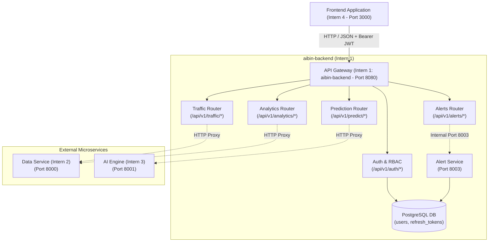

# TrafficVision AI — Backend Architecture & Service Structure (`structure.md`)

**Service Role**: API Gateway, Authentication Authority & Microservice Orchestrator  
**Owner**: Intern 1 (Team Lead / Backend & Integration)  
**Milestone**: Milestone 1 (SRS 1 Specification)

---

## 1. Directory Structure

```text
aibin-backend/
├── .env                     # Local environment settings
├── .env.example             # Template environment configuration
├── .gitignore               # Ignored files, cache, and virtual environments
├── requirements.txt         # Dependencies
├── structure.md             # Complete architecture and integration documentation
├── README.md                # Project overview, setup, and running guide
├── what.md                  # Comprehensive file-by-file technical reference
├── db.md                    # PostgreSQL database setup & integration guide
├── dbcommand.md             # 56+ Essential PostgreSQL queries & psql commands
├── test.md                  # Beginner's test guide, flowcharts & test explanations
├── docs.md                  # Interactive Swagger UI API testing walkthrough
├── commands.md              # Terminal commands quick reference
├── psql.md                  # PostgreSQL connection & administration guide
├── mainreadme.md            # Multi-service integration guide
├── dependencies.md          # Dependency tracking document (Milestone 3)
├── database/
│   └── schema.sql           # PostgreSQL DDL
├── scripts/
│   ├── simulate_congestion_trigger.py # Triggers congestion alerts
│   ├── anomaly_poller.py    # Polls AI service and triggers accident alerts
│   └── closure_delay_trigger.py # Monitors routes for severe delays
├── alert_service/
│   ├── main.py              # Alert Service FastAPI instance
│   ├── models.py            # Alert table definition
│   ├── schemas.py           # Alert pydantic schemas
│   ├── database.py          # Alert Service DB configuration
│   ├── Dockerfile           # Standalone dockerfile
│   └── routers/
│       └── alerts.py        # /api/v1/alerts internals
├── app/
│   ├── __init__.py
│   ├── main.py              # FastAPI app instance, router assembly, Swagger UI
│   ├── config.py            # Pydantic BaseSettings loading from .env
│   ├── database.py          # SQLAlchemy engine, session maker, get_db() dependency
│   ├── models.py            # SQLAlchemy ORM models (User, RefreshToken)
│   ├── schemas.py           # Pydantic request/response validation schemas
│   ├── auth/
│   │   ├── __init__.py
│   │   ├── dependencies.py  # JWT token validation & RBAC
│   │   ├── router.py        # /api/v1/auth
│   │   └── security.py      # Bcrypt & PyJWT utilities
│   └── gateway/
│       ├── __init__.py
│       ├── traffic_proxy.py # /api/v1/traffic
│       ├── prediction_proxy.py # /api/v1/predict
│       ├── route_proxy.py   # /api/v1/route
│       ├── alert_proxy.py   # /api/v1/alerts (Gateway to Alert Service)
│       └── analytics_proxy.py # /api/v1/analytics
└── tests/
    ├── test_auth.py         # Authentication tests
    └── test_rbac.py         # RBAC tests
```

---

## 2. Multi-Service Integration Architecture



---

## 3. Database Models (SQLAlchemy ORM)

Defined in [`app/models.py`](file:///c:/Users/AIBIN%20SHIBU/OneDrive/Documents/trafficvision/aibin-backend/app/models.py):

### 1. `users` Table
- `id` (String, Primary Key, UUID): Unique user identifier.
- `name` (String, Not Null): Full name of the user.
- `email` (String, Unique, Index, Not Null): Login email address.
- `password_hash` (String, Not Null): Salted bcrypt password hash.
- `role` (String, Not Null, Default `"public"`): User role (`admin`, `traffic_operator`, `public`).
- `created_at` (DateTime, Server Default `now()`): Creation timestamp.

### 2. `refresh_tokens` Table
- `id` (String, Primary Key, UUID): Unique token record identifier.
- `user_id` (String, Foreign Key `users.id`): Associated user.
- `token_hash` (String, Not Null): Hashed refresh token string.
- `expires_at` (DateTime, Not Null): Expiration timestamp.

---

## 4. Frozen API Contracts (SRS 1 Specification)

### 4.1 Authentication Service (Section 7.1 — Owner: Intern 1)

* **Register User**:
  - `POST /api/v1/auth/register`
  - Body: `{"name": "...", "email": "...", "password": "...", "role": "public"}`
  - Response (201): `{"user_id": "...", "message": "User registered successfully", "role": "public"}`

* **Login (Token Issuance)**:
  - `POST /api/v1/auth/login`
  - Body: `{"email": "admin@trafficvision.ai", "password": "admin123"}`
  - Response (200): `{"access_token": "...", "refresh_token": "...", "role": "admin", "token_type": "bearer", "expires_in": 3600}`

* **Refresh Access Token**:
  - `POST /api/v1/auth/refresh`
  - Body: `{"refresh_token": "..."}`
  - Response (200): `{"access_token": "...", "token_type": "bearer", "expires_in": 3600}`

* **Get Current Profile**:
  - `GET /api/v1/auth/me`
  - Headers: `Authorization: Bearer <token>`
  - Response (200): `{"user_id": "...", "name": "...", "email": "...", "role": "admin"}`

---

### 4.2 Traffic Monitoring Service (Section 7.2 — Owner: Intern 2)

* **Live Traffic Feed**:
  - `GET /api/v1/traffic/live`
  - Response (200):
    ```json
    [
      {
        "road_id": 1,
        "vehicle_count": 85,
        "density": 0.45,
        "congestion_level": "MEDIUM",
        "updated_at": "2026-09-08T18:00:00Z"
      }
    ]
    ```

* **Road-Specific Readings & History**:
  - `GET /api/v1/traffic/road/{road_id}`
  - Response (200):
    ```json
    {
      "road_id": 1,
      "name": "MG Road Junction",
      "congestion_level": "MEDIUM",
      "history": [
        {
          "timestamp": "2026-09-08T18:00:00Z",
          "vehicle_count": 85,
          "density": 0.42,
          "congestion_level": "MEDIUM"
        }
      ]
    }
    ```

* **Traffic Density KPI Metrics**:
  - `GET /api/v1/traffic/density`
  - Response (200): Aggregated density KPIs for dashboard.

---

### 4.3 AI Engine Service — Heuristic Stub (Section 7.3 — Owner: Intern 3)

* **Heuristic Congestion Prediction**:
  - `GET /api/v1/predict/congestion?road_id={id}`
  - Response (200):
    ```json
    {
      "road_id": "1",
      "predicted_level": "MEDIUM",
      "confidence": 0.80,
      "generated_by": "heuristic-v0"
    }
    ```

---

## 5. Verification & Test Execution

Run the complete test suite with `pytest`:

```powershell
.\.venv\Scripts\pytest tests/ -v
```

**Test Coverage**:
- `tests/test_auth.py`: Registration, Login, Refresh, Me endpoint, Duplicate Email rejection.
- `tests/test_rbac.py`: Role-Based Access Control verification across Admin, Operator, and Public roles.
