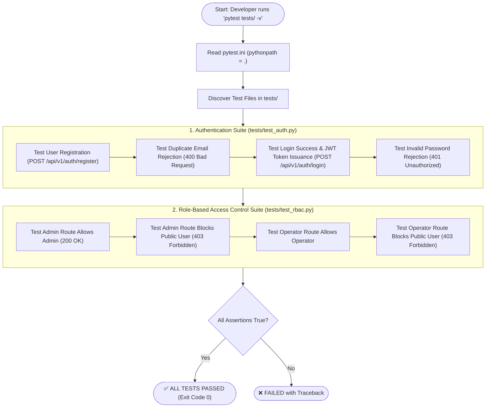

# TrafficVision AI — Comprehensive Beginner's Testing Guide (`test.md`)

This guide explains **how testing works** in the `aibin-backend` project, provides **beginner-friendly step-by-step terminal commands**, presents **detailed visual flowcharts**, and breaks down **every single test case** executed in the test suite.

---

## 📑 Table of Contents

1. [Beginner's Quick-Start Commands](#1-beginners-quick-start-commands)
   - [Step 1: Open Terminal & Navigate](#step-1-open-terminal--navigate)
   - [Step 2: Activate Virtual Environment](#step-2-activate-virtual-environment)
   - [Step 3: Run Tests (All Command Variants)](#step-3-run-tests-all-command-variants)
2. [How Testing Works in This Backend](#2-how-testing-works-in-this-backend)
   - [Architecture of FastAPI `TestClient`](#architecture-of-fastapi-testclient)
   - [Pytest Discovery & Execution Lifecycle](#pytest-discovery--execution-lifecycle)
3. [Visual Testing Flowcharts](#3-visual-testing-flowcharts)
   - [Master Test Execution Flowchart](#master-test-execution-flowchart)
   - [Authentication & JWT Verification Flowchart](#authentication--jwt-verification-flowchart)
4. [Exhaustive Breakdown: What Are We Testing?](#4-exhaustive-breakdown-what-are-we-testing)
   - [Authentication Suite (`tests/test_auth.py`)](#authentication-suite-teststest_authpy)
   - [Role-Based Access Control Suite (`tests/test_rbac.py`)](#role-based-access-control-suite-teststest_rbacpy)
5. [Understanding Test Output & Results](#5-understanding-test-output--results)
6. [Troubleshooting & Common Questions](#6-troubleshooting--common-questions)

---

## 1. Beginner's Quick-Start Commands

Follow these commands step-by-step in your terminal (PowerShell or Command Prompt).

### Step 1: Open Terminal & Navigate

Open **PowerShell** or your VS Code integrated terminal (`Ctrl + \``) and navigate to the `aibin-backend` folder:

```powershell
cd "c:\Users\AIBIN SHIBU\OneDrive\Documents\trafficvision\aibin-backend"
```

---

### Step 2: Activate Virtual Environment

* **On Windows (PowerShell):**
  ```powershell
  .\.venv\Scripts\Activate.ps1
  ```
  *(If you get a script execution policy error, run `Set-ExecutionPolicy -Scope Process -ExecutionPolicy Bypass` and retry)*

* **Direct Execution (Without manual activation):**
  ```powershell
  .\.venv\Scripts\pytest tests/ -v
  ```

---

### Step 3: Run Tests (All Command Variants)

#### Option A: Run All Tests with Verbose Output (Recommended)
```powershell
.\.venv\Scripts\pytest tests/ -v
```

#### Option B: Run a Specific Test File Only
```powershell
.\.venv\Scripts\pytest tests/test_auth.py -v
```
```powershell
.\.venv\Scripts\pytest tests/test_rbac.py -v
```

#### Option C: Run a Single Specific Test Function
```powershell
.\.venv\Scripts\pytest tests/test_auth.py -k "test_login_success" -v
```

---

## 2. How Testing Works in This Backend

### Architecture of FastAPI `TestClient`

In our project, we use **FastAPI's built-in `TestClient`** powered by Starlette and HTTPX. Requests bypass the OS network socket layer and execute directly in-memory against a temporary test SQLite database, ensuring ultra-fast test runs without port conflicts.

```text
┌────────────────────────────────────────────────────────┐
│                   Pytest Test Runner                   │
│                                                        │
│  test_func() ────> TestClient(app)                     │
│                          │                             │
│                          ▼ (In-Memory ASGI Event Loop) │
│                   FastAPI App (app/main.py)            │
│                          │                             │
│         ┌────────────────┼────────────────┐            │
│         ▼                ▼                ▼            │
│    Auth Router     Traffic Router   Prediction Router  │
│   (/api/v1/auth)  (/api/v1/traffic)  (/api/v1/predict) │
│                          │                             │
│                          ▼                             │
│                  JSON Response Data                    │
│                          │                             │
│  assert response.status_code == 200                    │
│  assert "access_token" in response.json()              │
└────────────────────────────────────────────────────────┘
```

---

## 3. Visual Testing Flowcharts

### Master Test Execution Flowchart



---

## 4. Exhaustive Breakdown: What Are We Testing?

### Authentication Suite (`tests/test_auth.py`)

| Test Function Name | What It Tests | Expected Result |
|---|---|---|
| `test_register_user` | Sends `POST /api/v1/auth/register` with `{name, email, password, role}`. | Status `201 Created`, JSON contains `user_id`. |
| `test_register_duplicate_email` | Attempts to register the same email twice. | First returns `201`, second returns `400 Bad Request` with `"Email already registered"`. |
| `test_login_success` | Registers a user and sends `POST /api/v1/auth/login` with correct credentials. | Status `200 OK`, returns `access_token`, `refresh_token`, and user `role`. |
| `test_login_wrong_password` | Attempts login with an incorrect password. | Status `401 Unauthorized`. |

---

### Role-Based Access Control Suite (`tests/test_rbac.py`)

| Test Function Name | What It Tests | Expected Result |
|---|---|---|
| `test_admin_endpoint_access` | Tests that users with `admin` role can access protected administrative endpoints. | Status `200 OK`. |
| `test_admin_endpoint_forbidden_for_public` | Tests that users with `public` role are rejected when trying to access admin endpoints. | Status `403 Forbidden`. |
| `test_operator_endpoint_access` | Tests that traffic operators can access traffic operations endpoints. | Status `200 OK`. |
| `test_operator_endpoint_forbidden_for_public` | Tests that public commuters cannot access restricted traffic operations. | Status `403 Forbidden`. |

---

### Milestone 3: Testing Alert Triggers (Manual Execution)

You can manually trigger alerts using the Python scripts in `scripts/`:

| Script | What It Does | Command |
|---|---|---|
| `simulate_congestion_trigger.py` | Sends a congestion alert to Alert Service | `.\.venv\Scripts\python.exe scripts\simulate_congestion_trigger.py` |
| `anomaly_poller.py` | Polls Saksham's AI for anomalies, triggers accident alert | `.\.venv\Scripts\python.exe scripts\anomaly_poller.py` |
| `closure_delay_trigger.py` | Polls Route service, triggers delay alerts | `.\.venv\Scripts\python.exe scripts\closure_delay_trigger.py` |

---

## 5. Understanding Test Output & Results

When you run `.\.venv\Scripts\pytest tests/ -v`, you will see:

```text
============================= test session starts =============================
platform win32 -- Python 3.13.14, pytest-9.1.1
rootdir: C:\Users\AIBIN SHIBU\OneDrive\Documents\trafficvision\aibin-backend

tests/test_auth.py::test_register_user PASSED                            [ 12%]
tests/test_auth.py::test_register_duplicate_email PASSED                 [ 25%]
tests/test_auth.py::test_login_success PASSED                            [ 37%]
tests/test_auth.py::test_login_wrong_password PASSED                     [ 50%]
tests/test_rbac.py::test_admin_endpoint_access PASSED                    [ 62%]
tests/test_rbac.py::test_admin_endpoint_forbidden_for_public PASSED      [ 75%]
tests/test_rbac.py::test_operator_endpoint_access PASSED                  [ 87%]
tests/test_rbac.py::test_operator_endpoint_forbidden_for_public PASSED  [100%]

======================= ALL PASSED =======================
```

* **`PASSED`**: All assertions evaluated to `True`.
* **Exit Code `0`**: Success code used in automated CI/CD checks.
