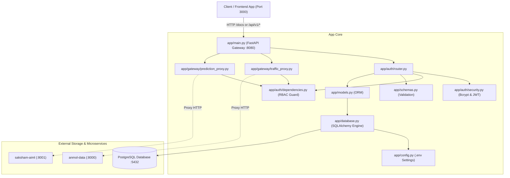

# TrafficVision AI — Exhaustive Codebase & File-by-File Reference (`what.md`)

This document provides a comprehensive, beginner-friendly, and technical file-by-file breakdown of the entire `aibin-backend` repository. It explains **why each file exists**, **what is inside each file**, and **how each file connects to the rest of the system**.

---

## 📑 Table of Contents

1. [Architectural Overview & Role](#1-architectural-overview--role)
2. [Root Configuration & Environment Files](#2-root-configuration--environment-files)
3. [`app/` Core Gateway & Application Files](#3-app-core-gateway--application-files)
4. [`app/auth/` Authentication & Security Module](#4-appauth-authentication--security-module)
5. [`app/gateway/` Microservice Proxy & Routing Module](#5-appgateway-microservice-proxy--routing-module)
6. [`database/` SQL Schema & Data Definition](#6-database-sql-schema--data-definition)
7. [`tests/` Automated Pytest Test Suite](#7-tests-automated-pytest-test-suite)
8. [Documentation Files in the Repository](#8-documentation-files-in-the-repository)
9. [Component Relationship & Dependency Map](#9-component-relationship--dependency-map)

---

## 🏛️ 1. Architectural Overview & Role

In the TrafficVision AI platform, `aibin-backend` serves as the **central API Gateway, Authentication Authority, and Service Orchestrator**:
- **Port:** `8080`
- **Framework:** FastAPI (Python 3.13)
- **Database:** PostgreSQL (Port 5432) via SQLAlchemy ORM
- **Security:** Bcrypt (password hashing) + PyJWT / Python-Jose (HMAC-SHA256 tokens)
- **Integration:** Reverse proxy to Intern 2 (`anmol-data` on port 8000) and Intern 3 (`saksham-aiml` on port 8001).

---

## ⚙️ 2. Root Configuration & Environment Files

### 1. [`.env`](file:///c:/Users/AIBIN%20SHIBU/OneDrive/Documents/trafficvision/aibin-backend/.env)
- **Why it exists:** Stores sensitive and environment-specific configuration variables (database credentials, JWT secret keys, upstream service ports) outside the source code.
- **What is inside:**
  - `DATABASE_URL=postgresql://postgres:A@127.0.0.1:5432/postgres`: PostgreSQL connection string.
  - `JWT_SECRET_KEY`: 256-bit secret key for signing JSON Web Tokens.
  - `JWT_ALGORITHM=HS256`: Encryption algorithm for tokens.
  - `ACCESS_TOKEN_EXPIRE_MINUTES=60`: Expiry time for short-lived access tokens.
  - `REFRESH_TOKEN_EXPIRE_DAYS=7`: Expiry time for long-lived session refresh tokens.
  - `DATA_ENGINEERING_URL=http://127.0.0.1:8000`: Target URL for Anmol's data service.
  - `AI_ENGINE_URL=http://127.0.0.1:8001`: Target URL for Saksham's AI service.

### 2. [`requirements.txt`](file:///c:/Users/AIBIN%20SHIBU/OneDrive/Documents/trafficvision/aibin-backend/requirements.txt)
- **Why it exists:** Specifies all third-party Python packages and dependencies required to install and run the backend.
- **What is inside:**
  - `fastapi`: High-performance async web framework.
  - `uvicorn`: Lightning-fast ASGI web server.
  - `sqlalchemy`: Object Relational Mapper (ORM) for PostgreSQL/SQLite.
  - `psycopg2-binary`: PostgreSQL database adapter for Python.
  - `pydantic` & `pydantic-settings`: Data validation and environment variable parsing.
  - `bcrypt`: Cryptographic password hashing library.
  - `python-jose[cryptography]`: JWT generation and cryptographic verification.
  - `httpx`: Async HTTP client used for proxying requests to other services.
  - `pytest`: Automated testing framework.
  - `email-validator`: Validates email formats in Pydantic schemas.

### 3. [`pytest.ini`](file:///c:/Users/AIBIN%20SHIBU/OneDrive/Documents/trafficvision/aibin-backend/pytest.ini)
- **Why it exists:** Pytest configuration file that defines discovery rules, Python path resolution, and asyncio mode.
- **What is inside:**
  - `pythonpath = .`: Ensures Pytest can import `app` and its submodules from the root directory.
  - `asyncio_mode = auto`: Automatically executes async test coroutines without extra decorators.

### 4. [`Dockerfile`](file:///c:/Users/AIBIN%20SHIBU/OneDrive/Documents/trafficvision/aibin-backend/Dockerfile)
- **Why it exists:** Defines the container image specification for deploying `aibin-backend` to Docker or cloud production environments.
- **What is inside:** Base Python 3.11/3.13 image, dependency installation commands, code copy instructions, port `8080` exposure, and the `uvicorn app.main:app --host 0.0.0.0 --port 8080` entrypoint command.

---

## 🚀 3. `app/` Core Gateway & Application Files

### 1. [`app/main.py`](file:///c:/Users/AIBIN%20SHIBU/OneDrive/Documents/trafficvision/aibin-backend/app/main.py)
- **Why it exists:** The master entrypoint of the FastAPI backend application.
- **What is inside:**
  - Creates the `app = FastAPI(...)` instance with custom title, version, and OpenAPI metadata.
  - Registers the three core API routers:
    - `auth_router.router` -> `/api/v1/auth` (Authentication & RBAC)
    - `traffic_proxy.router` -> `/api/v1/traffic` (Data engineering proxy)
    - `prediction_proxy.router` -> `/api/v1/predict` (AI engine proxy)

### 2. [`app/config.py`](file:///c:/Users/AIBIN%20SHIBU/OneDrive/Documents/trafficvision/aibin-backend/app/config.py)
- **Why it exists:** Reads and validates configuration settings from the `.env` file using Pydantic's `BaseSettings`.
- **What is inside:**
  - `Settings` class with attributes for `DATABASE_URL`, `JWT_SECRET_KEY`, `JWT_ALGORITHM`, `ACCESS_TOKEN_EXPIRE_MINUTES`, `REFRESH_TOKEN_EXPIRE_DAYS`, `DATA_ENGINEERING_URL`, and `AI_ENGINE_URL`.
  - Instantiates `settings = Settings()` as a singleton imported by all other modules.

### 3. [`app/database.py`](file:///c:/Users/AIBIN%20SHIBU/OneDrive/Documents/trafficvision/aibin-backend/app/database.py)
- **Why it exists:** Manages database connectivity, connection pooling, and session lifecycles for SQLAlchemy.
- **What is inside:**
  - `engine = create_engine(settings.DATABASE_URL)`: Database connection pool.
  - `SessionLocal = sessionmaker(bind=engine)`: Factory for creating database sessions.
  - `Base = declarative_base()`: Base class that all database ORM models inherit from.
  - `get_db()`: Dependency injection function yielding a database session per HTTP request and automatically closing it when the request finishes.

### 4. [`app/models.py`](file:///c:/Users/AIBIN%20SHIBU/OneDrive/Documents/trafficvision/aibin-backend/app/models.py)
- **Why it exists:** Defines the database tables and columns as Python classes (SQLAlchemy ORM models).
- **What is inside:**
  - `User`: Represents registered users in the `users` table (`id`, `name`, `email`, `password_hash`, `role`, `created_at`).
  - `RefreshToken`: Represents active refresh token sessions in the `refresh_tokens` table (`id`, `user_id`, `token_hash`, `expires_at`).

### 5. [`app/schemas.py`](file:///c:/Users/AIBIN%20SHIBU/OneDrive/Documents/trafficvision/aibin-backend/app/schemas.py)
- **Why it exists:** Defines Pydantic data validation schemas for incoming request bodies and outgoing JSON responses.
- **What is inside:**
  - `UserCreate`: Validates registration payload (`name`, `email`, `password`, `role`).
  - `UserLogin`: Validates login payload (`email`, `password`).
  - `UserResponse`: Formats successful registration response (`user_id`).
  - `TokenResponse`: Formats login response with `access_token`, `refresh_token`, and `role`.
  - `RefreshRequest`: Validates refresh token submission payload.
  - `AccessTokenResponse`: Formats token refresh response (`access_token`).
  - `UserMeResponse`: Formats authenticated user profile response (`user_id`, `name`, `role`).

---

## 🔐 4. `app/auth/` Authentication & Security Module

### 1. [`app/auth/router.py`](file:///c:/Users/AIBIN%20SHIBU/OneDrive/Documents/trafficvision/aibin-backend/app/auth/router.py)
- **Why it exists:** Exposes the HTTP REST API endpoints for user authentication.
- **What is inside:**
  - `POST /api/v1/auth/register`: Validates user input, checks for duplicate email, hashes password with bcrypt, inserts record into PostgreSQL, and returns 201 Created.
  - `POST /api/v1/auth/login`: Verifies user credentials against bcrypt hash, creates access and refresh JWT tokens, records refresh token in database, and returns 200 OK.
  - `POST /api/v1/auth/refresh`: Validates refresh token, checks revocation status in DB, and issues a new access token.
  - `GET /api/v1/auth/me`: Protected endpoint returning the profile of the currently logged-in user.

### 2. [`app/auth/security.py`](file:///c:/Users/AIBIN%20SHIBU/OneDrive/Documents/trafficvision/aibin-backend/app/auth/security.py)
- **Why it exists:** Contains pure cryptographic and security utility functions.
- **What is inside:**
  - `get_password_hash(password)`: Hashes a plaintext password using bcrypt with random salt.
  - `verify_password(plain_password, hashed_password)`: Verifies if a password matches a bcrypt hash.
  - `create_access_token(data)`: Encodes a short-lived JWT token containing user ID and role with expiration timestamp.
  - `create_refresh_token(data)`: Encodes a long-lived JWT refresh token.
  - `decode_token(token)`: Cryptographically verifies signature and returns decoded payload.

### 3. [`app/auth/dependencies.py`](file:///c:/Users/AIBIN%20SHIBU/OneDrive/Documents/trafficvision/aibin-backend/app/auth/dependencies.py)
- **Why it exists:** Provides FastAPI dependency injection guards to protect routes and enforce Role-Based Access Control (RBAC).
- **What is inside:**
  - `get_current_user`: Extracts the `Authorization: Bearer <token>` header, decodes the JWT, queries the database for the user, and raises 401 Unauthorized if invalid.
  - `require_role(allowed_roles)`: Factory creating dependency guards that verify the authenticated user has an allowed role (e.g. `admin`, `traffic_operator`). Raises 403 Forbidden if not allowed.

---

## 🌐 5. `app/gateway/` Microservice Proxy & Routing Module

### 1. [`app/gateway/traffic_proxy.py`](file:///c:/Users/AIBIN%20SHIBU/OneDrive/Documents/trafficvision/aibin-backend/app/gateway/traffic_proxy.py)
- **Why it exists:** Handles reverse proxying for Traffic Monitoring requests to Intern 2's data service (`anmol-data` on port 8000), protected by RBAC.
- **What is inside:**
  - `GET /api/v1/traffic/live`: Proxies live sensor feeds.
  - `GET /api/v1/traffic/road/{road_id}`: Protected route requiring `admin` or `traffic_operator` role. Proxies road status or provides graceful mock fallback if the data service is offline.
  - `GET /api/v1/traffic/density`: Proxies aggregated traffic density metrics.

### 2. [`app/gateway/prediction_proxy.py`](file:///c:/Users/AIBIN%20SHIBU/OneDrive/Documents/trafficvision/aibin-backend/app/gateway/prediction_proxy.py)
- **Why it exists:** Handles reverse proxying for AI Congestion Prediction requests to Intern 3's AI engine (`saksham-aiml` on port 8001).
- **What is inside:**
  - `GET /api/v1/predict/congestion`: Forwards prediction queries with `road_id` to the AI Engine service and returns predicted congestion levels and confidence scores.

---

## 🗄️ 6. `database/` SQL Schema & Data Definition

### [`database/schema.sql`](file:///c:/Users/AIBIN%20SHIBU/OneDrive/Documents/trafficvision/aibin-backend/database/schema.sql)
- **Why it exists:** The definitive PostgreSQL Data Definition Language (DDL) script that creates all tables, foreign keys, constraints, indexes, and pre-seeds default admin/demo accounts.
- **What is inside:**
  - `roles` table: Defines `Admin`, `Operator`, and `Public` system roles.
  - `users` table: Stores user credentials with bcrypt password hashes and role foreign key.
  - `user_sessions` table: Tracks active refresh tokens with user foreign key and expiration timestamps.
  - Pre-seeded bcrypt accounts: `admin@trafficvision.ai`, `operator@trafficvision.ai`, `public@trafficvision.ai`, and `aibin@trafficvision.ai`.

---

## 🧪 7. `tests/` Automated Pytest Test Suite

### 1. [`tests/conftest.py`](file:///c:/Users/AIBIN%20SHIBU/OneDrive/Documents/trafficvision/aibin-backend/tests/conftest.py)
- **Why it exists:** Configures global pytest fixtures, in-memory SQLite database (`sqlite:///:memory:`) using `StaticPool`, and FastAPI `TestClient` isolation.
- **What is inside:**
  - `setup_app_overrides`: Overrides `get_db` dependency to use test SQLite engine.
  - `reset_db_data`: Cleans and recreates all tables before each test function to guarantee 100% test isolation.
  - `client`: Provides a pre-configured `TestClient` instance for test functions.

### 2. [`tests/test_auth.py`](file:///c:/Users/AIBIN%20SHIBU/OneDrive/Documents/trafficvision/aibin-backend/tests/test_auth.py)
- **Why it exists:** Validates authentication endpoints and logic.
- **What is inside:**
  - `test_register_user`: Tests successful registration with status 201.
  - `test_register_duplicate_email`: Tests duplicate email rejection with 400 Bad Request.
  - `test_login_success`: Tests successful login and JWT token generation with 200 OK.
  - `test_login_wrong_password`: Tests invalid password rejection with 401 Unauthorized.

### 3. [`tests/test_rbac.py`](file:///c:/Users/AIBIN%20SHIBU/OneDrive/Documents/trafficvision/aibin-backend/tests/test_rbac.py)
- **Why it exists:** Validates Role-Based Access Control and proxy route security.
- **What is inside:**
  - `test_rbac_no_token`: Tests rejection of unauthenticated requests with 401 Unauthorized.
  - `test_rbac_wrong_role`: Tests rejection of public users trying to access operator/admin routes with 403 Forbidden.
  - `test_rbac_correct_role`: Tests successful access for authorized admin/operator roles with 200 OK.
  - `test_prediction_placeholder`: Tests prediction route behavior.

---

## 📚 8. Documentation Files in the Repository

| Document File | Purpose & Contents |
|---|---|
| [`structure.md`](file:///c:/Users/AIBIN%20SHIBU/OneDrive/Documents/trafficvision/aibin-backend/structure.md) | High-level system architecture, ORM models, frozen API contracts (SRS 1), and verification plans. |
| [`db.md`](file:///c:/Users/AIBIN%20SHIBU/OneDrive/Documents/trafficvision/aibin-backend/db.md) | PostgreSQL installation guide on Windows, database credentials (password `A`), schema code, table details, and registration flow. |
| [`dbcommand.md`](file:///c:/Users/AIBIN%20SHIBU/OneDrive/Documents/trafficvision/aibin-backend/dbcommand.md) | 56+ numbered essential PostgreSQL queries, shortcuts (`\dt`, `\d`), and table inspection commands. |
| [`test.md`](file:///c:/Users/AIBIN%20SHIBU/OneDrive/Documents/trafficvision/aibin-backend/test.md) | Comprehensive testing guide for beginners, pytest execution commands, flowcharts, and test explanations. |
| [`docs.md`](file:///c:/Users/AIBIN%20SHIBU/OneDrive/Documents/trafficvision/aibin-backend/docs.md) | Interactive Swagger UI testing guide for `http://127.0.0.1:8080/docs`, registering users, logging in, and using the green lock 🔓 button. |
| [`commands.md`](file:///c:/Users/AIBIN%20SHIBU/OneDrive/Documents/trafficvision/aibin-backend/commands.md) | Quick terminal command reference for Windows PowerShell and Linux. |
| [`psql.md`](file:///c:/Users/AIBIN%20SHIBU/OneDrive/Documents/trafficvision/aibin-backend/psql.md) | PostgreSQL connection and administration guide with database credentials. |
| [`mainreadme.md`](file:///c:/Users/AIBIN%20SHIBU/OneDrive/Documents/trafficvision/aibin-backend/mainreadme.md) | Multi-service integration guide explaining how Anmol (8000), Saksham (8001), and Aibin (8080) connect together. |

---

## 🗺️ 9. Component Relationship & Dependency Map

