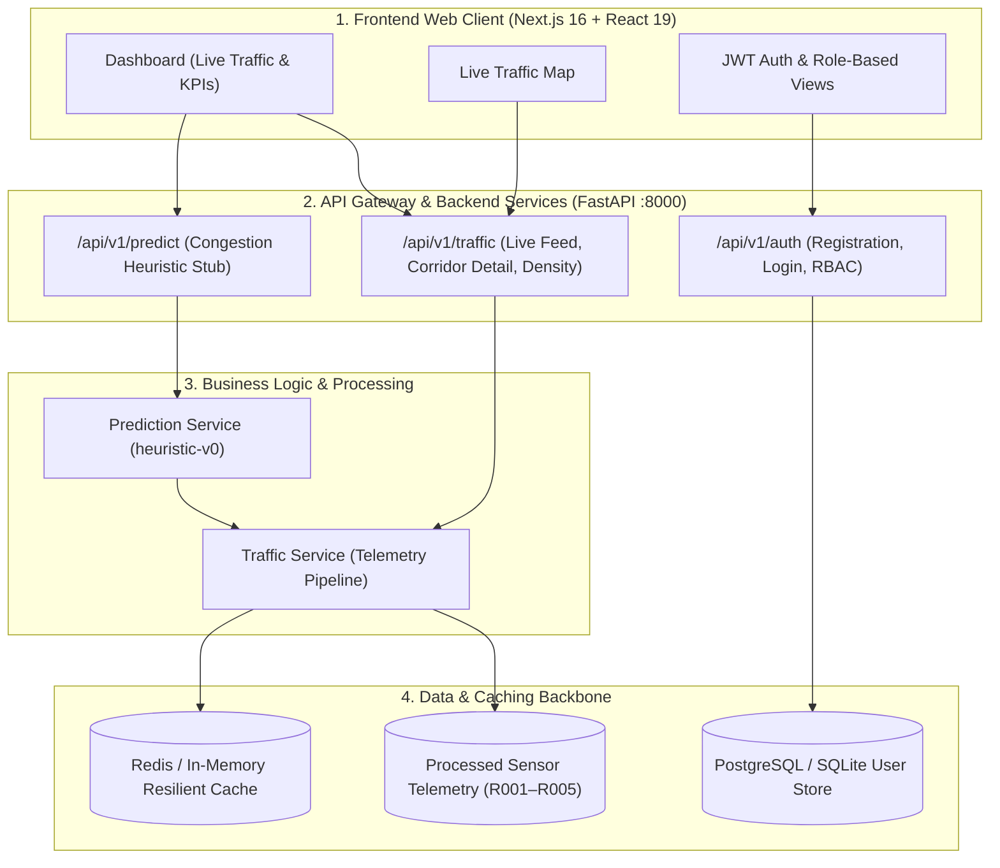

# TrafficVision AI — Smart Traffic Prediction & Congestion Management System
**Milestone 1 — Project Initialization, Design Process & Core Setup**

[](https://github.com/springboardmentor98765v/Traffic-Prediction-and-Intelligent-Congestion-Management-/actions/workflows/ci.yml)
[]()
[]()
[]()

TrafficVision AI is a centralized urban traffic management platform that ingests real-time and historical telemetry from CCTV/sensors, computes congestion levels, recommends alternate routes, and raises automated alerts for city traffic authorities and operators.

---

## 🏛️ System Architecture — Milestone 1 Increment

The Milestone 1 increment establishes the core foundation across five synchronized domains:



---

## 👥 Intern Team Domain Ownership

| Intern | Domain | Architecture Responsibility |
|:------:|:-------|:---------------------------|
| **Intern 1** | **Team Lead / Backend & Integration** | Unified FastAPI Gateway, JWT Authentication, RBAC middleware, API contracts. |
| **Intern 2** | **Data Engineering & Traffic Monitoring** | Traffic data schema, ingestion pipeline, congestion tracking, Redis caching. |
| **Intern 3** | **AI/ML & Intelligent Routing** | Heuristic prediction stub (`heuristic-v0`), feature planning, M2 ML model roadmap. |
| **Intern 4** | **Frontend & Application Services** | Next.js 16 + Tailwind CSS application, login flow, live traffic dashboard, role-aware UI. |
| **Intern 5** | **QA, DevOps & Release Engineering** | GitHub Actions CI workflow, local Docker Compose setup, automated pytest suites, sign-off reports. |

> [!IMPORTANT]
> **Deployment Scope**: In accordance with SRS Section 1.2, production deployment is excluded from Milestone 1 and is deferred until after Milestone 4. Everything runs locally or inside Docker Compose.

---

## 🚀 Quick Start & Demo Walkthrough

### Option 1: Native Local Run (Zero Docker Required)

#### 1. Launch Backend API Gateway
```bash
# In terminal 1:
cd Backend
pip install -r requirements.txt
python run.py
```
*The FastAPI Backend will start on `http://localhost:8000`.*  
*Interactive Swagger docs: `http://localhost:8000/docs`*

#### 2. Launch Frontend Next.js Application
```bash
# In terminal 2:
npm install
npm run dev
```
*The Next.js frontend will start on `http://localhost:3000`.*

---

### Option 2: Local Docker Compose

```bash
docker compose -f docker-compose.dev.yml up --build
```
*Spins up PostgreSQL, Redis, and the FastAPI Backend together on your local machine.*

---

## 🧪 Running Automated Test Suites

All 29 automated tests across all 5 domains can be executed with a single command:

```powershell
# 1. Backend Core & RBAC Tests (11 tests)
python -m pytest Backend/tests -v

# 2. Data Engineering Pipeline Tests (4 tests)
python -m pytest Komal_Data-Engineering-Traffic-Monitoring/test_data_pipeline.py -v

# 3. AI Heuristic Engine Tests (3 tests)
python -m pytest Sowjanya-ai-ml/src/test_congestion_predictor.py -v

# 4. Live API Integration Suite (11 tests - with Backend running)
python -m pytest srinath-devops/API_TESTING_SKELETON/tests -v

# 5. Frontend Production Build & Typecheck
npm run build
```

---

## 🔑 Demo Walkthrough Guide (For Mentors & Reviewers)

1. Open **[http://localhost:3000](http://localhost:3000)** in your browser.
2. Click **Sign In**:
   - Use the **One-Click Demo Login** buttons for instant access:
     - 👑 **Admin**: Full access including user list from `/api/v1/auth/users`.
     - 🛠️ **Operator**: Access to traffic monitoring controls, signal adjustments, and incident broadcasts.
     - 🚗 **Public**: Commuter advisory and live corridor status.
3. Explore the **Dashboard (`/dashboard`)**:
   - View live road corridors: `R001 (MG Road)`, `R002 (Ring Road)`, `R003 (Station Road)`, `R004 (Airport Road)`, `R005 (Civil Lines)`.
   - Inspect live density, vehicle counts, and color-coded congestion badges.
   - Click **Predict** on any road to view the AI heuristic forecast with confidence metrics.
4. Explore the **Live Traffic Map (`/live-map`)**:
   - Interactive GIS arterial network map with live color-coded node pins.
5. Review the **Milestone 1 Sign-Off Report**:
   - Read [`srinath-devops/QA/reports/milestone1-final-integration-signoff.md`](srinath-devops/QA/reports/milestone1-final-integration-signoff.md).
6. Review the **Milestone 2 AI Roadmap**:
   - Read [`Sowjanya-ai-ml/docs/m2_ml_roadmap.md`](Sowjanya-ai-ml/docs/m2_ml_roadmap.md).
