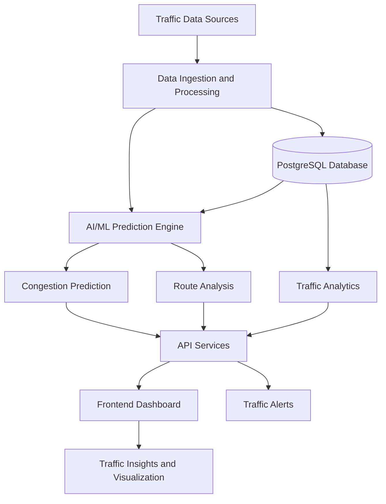
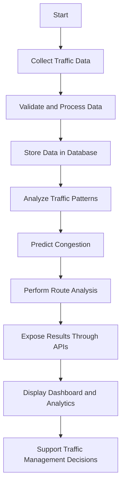

# TrafficVision AI – Smart Traffic Prediction & Congestion Management

TrafficVision AI is an AI-powered platform designed to support traffic monitoring, congestion prediction, route analysis, traffic analytics, and intelligent alerts. It combines data engineering, machine learning, database management, API services, and frontend visualization to support data-driven traffic management.

## 1. Project Overview

| Item | Description |
|---|---|
| Project Name | TrafficVision AI |
| Domain | Artificial Intelligence and Smart Traffic Management |
| Primary Goal | Traffic monitoring and congestion management |
| AI/ML | Traffic pattern analysis and congestion prediction |
| Data Management | Traffic data storage, processing, and analysis |
| Interface | Centralized traffic monitoring dashboard |

## 2. Problem Statement

Urban traffic congestion creates challenges for commuters and traffic authorities. Limited visibility into traffic patterns can make it difficult to anticipate congestion, assess road conditions, and identify alternative routes.

TrafficVision AI aims to bring traffic data, prediction capabilities, route analysis, and analytics together in a centralized platform.

## 3. Proposed Solution

The system combines traffic data processing, AI/ML analysis, database services, APIs, and an interactive dashboard to present useful traffic insights.

## 4. Key Features

| Feature | Description |
|---|---|
| Traffic Monitoring | View and analyze traffic conditions |
| Congestion Prediction | Predict congestion using traffic data and ML models |
| Route Analysis | Analyze routes and support alternative-route recommendations |
| Traffic Analytics | Examine traffic trends and patterns |
| Congestion Heatmaps | Visualize congestion across locations |
| Historical Reports | Review previously collected traffic information |
| Intelligent Alerts | Provide notifications about relevant traffic conditions |
| Dashboard | Present traffic information in a centralized interface |

*Feature descriptions should be updated to match the functionality currently implemented in the code.*

## 5. System Architecture



## 6. System Workflow



## 7. Technology Stack

| Component | Technologies |
|---|---|
| Programming Languages | Python, JavaScript |
| Data Processing | Pandas, NumPy |
| Machine Learning | Scikit-learn |
| API Services | FastAPI, REST APIs |
| Database | PostgreSQL |
| Caching | Redis |
| Frontend | Next.js, React, HTML, CSS |
| Containerization | Docker |
| Version Control | Git, GitHub |

*Include only the technologies actually used in the project.*

## 8. Repository Structure

```text
Traffic-Prediction-and-Intelligent-Congestion-Management-/
│
├── Aibin-Project/          # Backend and integration
├── Hariom-Frontend/        # Frontend and application services
├── Saksham-AI-ML/          # AI/ML and intelligent routing
├── anmol-data-engineering/ # Data engineering and traffic monitoring
├── .gitignore
├── LICENSE
└── README.md
```

## 9. Installation and Setup

### Prerequisites

| Tool | Purpose |
|---|---|
| Git | Clone and manage the repository |
| Python | Run Python-based services |
| Node.js and npm | Run the frontend |
| PostgreSQL | Store traffic data |
| Redis | Caching or queue-related functionality, if configured |
| Docker | Run containerized services, if configured |

### Step 1: Clone the Repository

```bash
git clone https://github.com/springboardmentor98765v/Traffic-Prediction-and-Intelligent-Congestion-Management-.git
```

### Step 2: Navigate to the Repository

```bash
cd Traffic-Prediction-and-Intelligent-Congestion-Management-
```

### Step 3: Configure the Components

Open the relevant component folder and follow its setup instructions. Configure database connections, environment variables, and dependencies before starting the services.

### Step 4: Run the Application

Use the component-specific startup commands provided in its README or setup documentation.

*Exact dependency installation, database migration, and run commands must be added after verifying each component's configuration.*

## 10. Team Contributions

| Team Member | Responsibility |
|---|---|
| Anmol Sharma | Team Lead & Data Engineering / Traffic Monitoring |
| Saksham Pandey | AI/ML & Intelligent Routing |
| Aibin Sibu | Backend & Integration |
| Hariom Kumar Trivedi | Frontend & Application Services |

## 11. Expected Outcomes

| Area | Intended Outcome |
|---|---|
| Monitoring | Better visibility into traffic conditions |
| Prediction | Identification of potential congestion |
| Route Analysis | Support for alternative-route decisions |
| Analytics | Insights from traffic trends and historical data |
| Integration | Traffic information accessible through a centralized platform |

## 12. Future Scope

- Integration with additional live traffic data sources
- Improved prediction accuracy through model evaluation
- Enhanced route recommendations using updated road conditions
- More detailed traffic visualization and reporting
- Further performance optimization and deployment improvements

## 13. License

Refer to the [LICENSE](LICENSE) file for licensing information.
