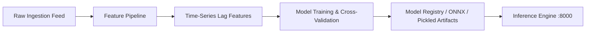

# TrafficVision AI — Milestone 2 AI/ML Roadmap & Handoff Document
**Author**: Intern 3 (AI/ML & Intelligent Routing)  
**Target Milestone**: Milestone 2 — Real Model Training, Feature Pipelines & Intelligent Routing  
**Document Status**: Frozen for Milestone 1 Review & Handoff  

---

## 1. Milestone 1 Scope Retrospective

In Milestone 1, the AI Engine delivered a **rule-based heuristic stub (`heuristic-v0`)** designed to establish interface stability across all consuming layers:
- **API Gateway (Intern 1)**: `/api/v1/predict/congestion?road_id={id}` and `/api/v1/predict/live`.
- **Frontend Dashboard (Intern 4)**: Real-time congestion prediction cards displaying `heuristic-v0` badge and 0.80 baseline confidence.
- **QA & Testing (Intern 5)**: Automated pytest suites validating response schemas and peak-hour adjustment rules.

### Heuristic Rule Summary
1. **Density Thresholds**:
   - `Density < 20.0` $\rightarrow$ `Low` Congestion
   - `20.0 <= Density <= 50.0` $\rightarrow$ `Medium` Congestion
   - `Density > 50.0` $\rightarrow$ `High` Congestion
2. **Time-of-Day Peak Hour Adjustments**:
   - Morning Peak (07:00–10:00) & Evening Peak (17:00–20:00) shift `Low` $\rightarrow$ `Medium` and `Medium` $\rightarrow$ `High`.

---

## 2. Milestone 2 ML Model Training Roadmap

Milestone 2 transitions the system from rule-based heuristics to supervised machine learning and time-series traffic forecasting.

### 2.1 Feature Engineering Pipeline
From the Exploratory Data Analysis (EDA) conducted in Milestone 1 on the synthetic and CCTV sensor datasets, the following feature set is planned:

| Feature Name | Type | Description | Source |
|--------------|------|-------------|--------|
| `road_id_encoded` | Categorical (One-Hot / Target) | Road identifier (R001–R005) | Intern 2 Schema |
| `vehicle_count_t` | Integer | Current vehicle volume | Sensor Feed |
| `vehicle_count_t-1` | Integer | Lag volume (15 min prior) | Time-Series DB |
| `avg_speed_kmh` | Float | Vehicle average speed | Sensor Feed |
| `density_pct` | Float | Road space occupancy % | Calculated |
| `hour_of_day` | Integer (Cyclic sin/cos) | Circadian traffic cycle (0–23) | Timestamp |
| `day_of_week` | Integer (0–6) | Weekday vs Weekend patterns | Timestamp |
| `is_peak_hour` | Binary (0/1) | Morning/Evening commuter window | Domain Rule |
| `weather_condition` | Categorical (Rain/Clear/Fog) | Environmental impact | Weather API Feed |

### 2.2 Model Architecture Candidates
1. **Baseline Model**: Logistic Regression / Decision Trees (for interpretable threshold benchmarks).
2. **Tabular Gradient Boosting**: **XGBoost** and **LightGBM** (high accuracy on multi-feature tabular sensor streams with fast inference < 5ms).
3. **Sequential Forecasting**: **LSTM** or **GRU** neural networks for multi-step horizon prediction (predicting congestion 30, 60, and 120 minutes into the future).

### 2.3 Evaluation Metrics
- **Classification**: Macro F1-Score, Multi-Class ROC-AUC, Confusion Matrix across Low/Medium/High.
- **Regression (for speed/density prediction)**: Mean Absolute Error (MAE), Root Mean Squared Error (RMSE), Mean Absolute Percentage Error (MAPE).
- Target Milestone 2 Benchmark: **Macro F1-Score $\ge 0.88$**.

---

## 3. Data Handoff Requirements from Intern 2 (Data Engineering)
For Milestone 2 model training to commence on Day 8:
1. **Continuous Historical Dataset**: At least 30 consecutive days of time-series readings sampled at 5-minute intervals for all roads (R001–R005).
2. **Sensor Anomaly Flagging**: Automated handling for missing sensor pings, negative density spikes, or sensor drift.
3. **PostgreSQL / TimescaleDB Read Replica**: Read access for feature extraction batch queries.

---

## 4. Intelligent Routing Expansion (Milestone 3 Preview)
Milestone 2 model outputs will directly feed Milestone 3's dynamic graph routing:
- Congestion-weighted A* / Dijkstra graph traversal.
- Rerouting suggestions when candidate road segment exceeds 65% predicted congestion probability.
