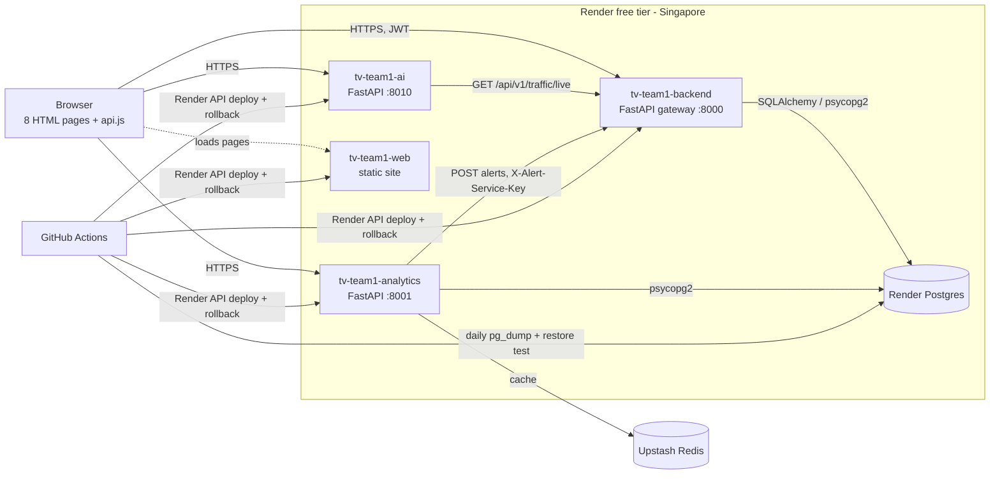

# TrafficVision AI — Architecture (final, Milestone 4)

## 1. System overview

| Service              | Owner    | Code                                                | Responsibilities                                                                               |
| -------------------- | -------- | --------------------------------------------------- | ---------------------------------------------------------------------------------------------- |
| `tv-team1-backend`   | Intern 1 | `backend_updated/backend/Intern_AI AND ML/app`      | Auth + RBAC (JWT), live monitoring, congestion prediction (model-v1), route analysis, alerts   |
| `tv-team1-analytics` | Intern 2 | `daa/M3_Day6_Traffic_Monitoring_/src`               | Live traffic with Redis cache, history, hourly/daily metrics, trends, heatmap, CSV reports     |
| `tv-team1-ai`        | Intern 3 | `TrafficVision-AI m3/TrafficVision-AI/ai-engine`    | Anomaly detection, explainable recommendations, live/manual predictions                        |
| `tv-team1-web`       | Intern 4 | `Front-end(m-3) (1)/Front-end`                      | Login (CAPTCHA), public/operator/admin dashboards, live map, route analysis, alerts, analytics |
| CI/CD, QA, release   | Intern 5 | `.github/workflows`, `render.yaml`, `QA/milestone4` | lint → build → test → deploy, rollback, backups, live test suites                              |

## 2. Key flows

**Login → dashboard.** `Login.html` validates the CAPTCHA in the browser, posts to
`/api/v1/auth/login`, stores the access/refresh tokens, and redirects by role
(`PUBLIC` → public dashboard, `OPERATOR`, `ADMIN`). Pages call `AuthManager.guardPage`,
which sends unauthenticated visitors back to Login.

**Live monitoring.** `GET /api/v1/traffic/live` reads the latest reading per road from
`traffic_readings` (gateway) or Redis-then-Postgres (analytics, 30 s TTL).

**Prediction and routing.** The gateway loads `ai-engine/models/model-v1.joblib`
(scikit-learn 1.9.0 pipeline) at start-up. Route endpoints call OSRM and score each route
with the congestion prediction; they require a JWT.

**Alerts.** Producers (congestion watcher, anomaly detector) post to `/api/v1/alerts/` with
`X-Alert-Service-Key`; operators/admins may post with their JWT. Readers get
`/api/v1/alerts/my`, scoped by the role in their token (public users never see Critical or
accident alerts).

**AI insights.** The AI Engine pulls live traffic from the gateway, compares with the
historical baseline for anomalies, and produces recommendations from model-v1 + trends.

## 3. Data model (PostgreSQL)

| Table                                             | Written by                        | Read by                     |
| ------------------------------------------------- | --------------------------------- | --------------------------- |
| `users`, `alerts`                                 | Gateway (created on start-up)     | Gateway                     |
| `roads`, `traffic_readings`                       | Ingestion / `setup_production_db` | Gateway, Analytics          |
| `traffic_history`                                 | Historical loader (4 weeks)       | Analytics, AI baseline      |
| `road_conditions`                                 | Road-condition ingestion          | Gateway, Analytics          |
| `hourly_traffic_metrics`, `daily_traffic_metrics` | Aggregation job                   | Analytics (trends, heatmap) |

Schema source: `daa/M3_Day6_Traffic_Monitoring_/database/schema.sql` and `sql/*.sql`.
`setup_production_db.py --check` compares a live database against it.

## 4. Environment variable contract (SRS 7.1)

| Variable                                   | Used by                   | Production value                                          |
| ------------------------------------------ | ------------------------- | --------------------------------------------------------- |
| `DATABASE_URL`                             | gateway, analytics, QA    | Render Postgres external URL `?sslmode=require`           |
| `REDIS_URL`                                | analytics (gateway ready) | Upstash `rediss://…`                                      |
| `JWT_SECRET_KEY`                           | gateway                   | generated by Render (service refuses to start without it) |
| `ALERT_SERVICE_KEY`                        | gateway, alert producers  | generated by Render, shared via env group                 |
| `CORS_ALLOWED_ORIGINS`                     | all three APIs            | `https://tv-team1-web.onrender.com`                       |
| `ALERT_API_URL`                            | analytics watcher         | gateway `/api/v1/alerts/`                                 |
| `TRAFFIC_API_URL`                          | AI Engine                 | gateway `/api/v1/traffic/live`                            |
| `ANALYTICS_CACHE_ENABLED` / `_TTL_SECONDS` | analytics                 | `true` / `60`                                             |

Local development keeps working without any of these (defaults point at the Docker
Compose services; CORS defaults to `*`).

## 5. Deployment pipeline

`ci.yml`: **lint** (flake8, Black, ESLint, Prettier, inline-script syntax) ∥ **build**
(3 images, pushed to GHCR from `main`) ∥ **tests** (pytest against Postgres + Redis
service containers) → **deploy** (Render API, exact commit, wait for live) → **health
gate** → **live smoke test** → automatic **rollback** on failure.

Images: backend and analytics use `python:3.12-slim` (backend Dockerfile; analytics reuses
it with its own context), AI uses `python:3.12-slim`. `.dockerignore` files keep `.env`,
virtualenvs and local databases out of every image.

## 6. Security

- JWT secret and alert key only in Render's env group / GitHub secrets, never in git.
- CORS restricted to the hosted frontend in production.
- Route analysis, profile and alert endpoints require a token; alert creation requires the
  service key or an operator/admin token; registration limited to allow-listed domains.
- All traffic over HTTPS (Render-managed certificates). Postgres over TLS
  (`sslmode=require`), Redis over TLS (`rediss://`).

## 7. Known limitations

- Free tier: services sleep after 15 min (≈1 min cold start), 512 MB RAM each, shared CPU.
- Render free Postgres expires 30 days after creation; daily backups make the move to a
  new database (or Neon) a restore + URL change.
- No background worker on the free tier: live readings are the loaded dataset, not a
  continuously running ingestion job.
