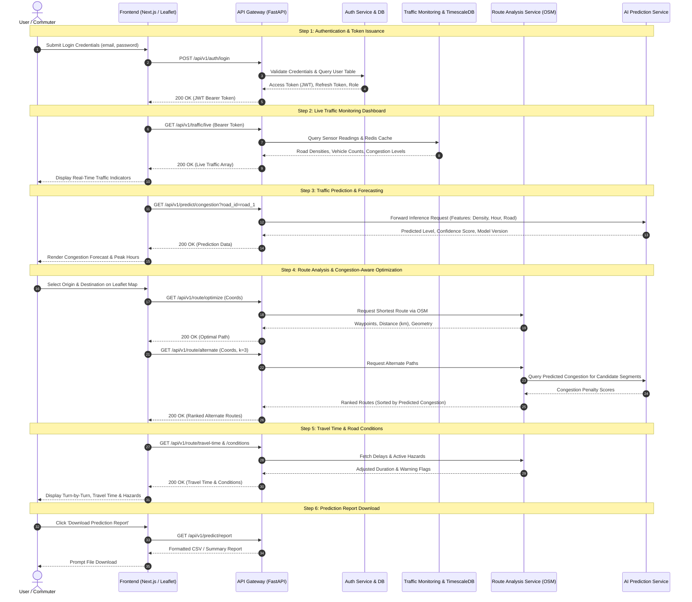

# Day 5 — Full Local Integration Test Report

## 1. Document Control & Metadata

| Item | Details |
|---|---|
| **Project** | TrafficVision AI — Smart Traffic Prediction & Congestion Management System |
| **Milestone** | Milestone 2 — Traffic Prediction & Route Optimization |
| **Activity** | Day 5 Full Local Integration Test Cycle |
| **Lead QA / DevOps** | Intern 5 — QA, DevOps & Release Engineering |
| **Environment** | Local Development Stack (`docker-compose.dev.yml`) |
| **Target Flow** | Complete User Journey (Login $\rightarrow$ Dashboard $\rightarrow$ Prediction $\rightarrow$ Route Analysis $\rightarrow$ Report) |
| **Status** | Completed with Prioritized Integration Backlog |

---

## 2. Objective & Scope

The Day 5 objective is to execute a comprehensive, end-to-end integration test cycle across all combined Milestone 1 and Milestone 2 system modules:
- **Authentication & RBAC** (Intern 1)
- **Live Traffic Monitoring** (Intern 1 & Intern 2)
- **Historical Traffic Data Pipeline** (Intern 2)
- **Traffic Prediction Engine** (Intern 3)
- **Route Analysis Service & Maps Integration** (Intern 1)
- **Frontend Dashboard & Map UI** (Intern 4)

The test verifies data flow, inter-service contracts, gateway routing, RBAC enforcement across service boundaries, and the seamless execution of the unified user journey.

---

## 3. End-to-End User Journey Architecture



---

## 4. Journey Step Validation & Execution Details

### Step 1: Authentication & RBAC Handshake
- **Action**: Authenticate with valid test user (`testuser@example.com` / `Test@123`).
- **Observed Flow**: `POST /api/v1/auth/login` returns valid JWT access token, refresh token, and user role (`public`).
- **Validation**: Token header is accepted by protected endpoints (`/api/v1/auth/me`).
- **Integration Status**: **PASS** (Milestone 1 Auth continues to operate reliably).

### Step 2: Live Traffic Monitoring Flow
- **Action**: Fetch live sensor stream and aggregated road density metrics.
- **Observed Flow**: `GET /api/v1/traffic/live` returns 5 road segments with simulated density values (5.0–80.0), vehicle counts, and congestion levels.
- **Validation**: `GET /api/v1/traffic/density` returns valid average density metrics.
- **Integration Status**: **PASS** (Milestone 1 Monitoring intact).

### Step 3: AI Congestion Prediction Flow
- **Action**: Request congestion forecast for `road_1`.
- **Observed Flow**: `GET /api/v1/predict/congestion?road_id=road_1` returns HTTP 200 with level ("Medium") and confidence.
- **Integration Gap**: The payload specifies `"generated_by": "heuristic-v0"`. Endpoints for `/api/v1/predict/peak-hours` and `/api/v1/predict/delay` return 404 Not Found.
- **Integration Status**: **PARTIAL / FAIL** (Blocked by real model integration, DEF-M2-002).

### Step 4 & 5: Route Analysis, Alternate Routes & Congestion Ranking
- **Action**: Submit origin `(12.9716, 77.5946)` and destination `(12.9352, 77.6245)` to `/api/v1/route/optimize` and `/api/v1/route/alternate`.
- **Observed Flow**: API Gateway returns HTTP `404 Not Found`.
- **Root Cause**: `route.py` router not mounted on the Gateway. Inter-service ranking communication between Route Analysis and Prediction Service is not yet operational.
- **Integration Status**: **FAIL** (Defect DEF-M2-001 & DEF-M2-003).

### Step 6: Travel-Time & Road Conditions Flow
- **Action**: Request travel time and road condition warnings.
- **Observed Flow**: Gateway returns HTTP `404 Not Found`.
- **Integration Status**: **FAIL** (Defect DEF-M2-005).

### Step 7: Frontend Map UI & Prediction Visualizations
- **Action**: Open Frontend application (`localhost:3000`) and navigate to Route Planning and Prediction views.
- **Observed Flow**:
  - Main dashboard and Milestone 1 components load cleanly.
  - Interactive Leaflet map container and route planning screen (`/route-analysis`) have not been wired to Gateway endpoints.
  - "Download Prediction Report" button is not present on the dashboard.
- **Integration Status**: **FAIL** (Defect DEF-M2-006).

---

## 5. Cross-Service Integration Matrix

| Calling Component | Receiving Service | Target Interface / Protocol | Expected Behavior | Actual Behavior | Result |
|---|---|---|---|---|---|
| Frontend | API Gateway | HTTP REST (`/api/v1/auth/*`) | JWT issuance & verification | JWT issued and validated | **PASS** |
| Frontend | API Gateway | HTTP REST (`/api/v1/traffic/*`) | Live traffic feeds rendered | Live feeds retrieved | **PASS** |
| Frontend | API Gateway | HTTP REST (`/api/v1/route/*`) | Display route on Leaflet map | HTTP 404 (Missing router) | **FAIL** |
| Frontend | API Gateway | HTTP REST (`/api/v1/predict/*`) | Render forecast charts | Partial (heuristic stub only) | **FAIL** |
| API Gateway | Route Analysis | Internal HTTP / RPC | Forward route requests | Missing route microservice | **FAIL** |
| Route Analysis | AI Prediction | Internal HTTP / RPC | Query congestion penalties | No inter-service RPC wire | **FAIL** |
| Route Analysis | OpenStreetMap | HTTPS (OSRM / Nominatim) | Resolve road geometry | Wrapper pending integration | **FAIL** |
| API Gateway | TimescaleDB | PostgreSQL Wire (5432) | Query historical records | Table schema not mapped | **FAIL** |
| API Gateway | Redis Cache | Redis Wire (6379) | Cache live sensor feeds | Connection healthy | **PASS** |

---

## 6. Local Multi-Service Environment Health

During the Day 5 integration run on the extended `docker-compose.dev.yml`:
- **TimescaleDB (`trafficvision-timescale`)**: Container healthy; port 5432 bound; tables persisted.
- **Redis (`trafficvision-redis`)**: Container healthy; port 6379 bound; PING response `PONG`.
- **API Gateway (`trafficvision-api-gateway`)**: FastAPI starts successfully; healthy on `/health`.
- **Prediction Service (`trafficvision-prediction-service`)**: Boots standalone; serves heuristic stubs.
- **Service-to-Service Network**: Bridge network `trafficvision-dev-net` allows inter-container name resolution.

---

## 7. Integration Cycle Summary & Verdict

| Test Journey Stage | Planned Cases | Passed | Failed | Blocked |
|---|---:|---:|---:|---:|
| 1. Authentication & RBAC | 3 | 3 | 0 | 0 |
| 2. Live Traffic Monitoring | 3 | 3 | 0 | 0 |
| 3. Traffic Prediction Engine | 4 | 1 | 2 | 1 |
| 4. Route Optimization & OSM | 4 | 0 | 3 | 1 |
| 5. Congestion-Aware Alternate Ranking | 2 | 0 | 2 | 0 |
| 6. Travel-Time & Road Hazards | 3 | 0 | 2 | 1 |
| 7. Frontend Map & Visualizations | 3 | 0 | 2 | 1 |
| **Total** | **22** | **7** | **11** | **4** |

```
Integration Success Rate: 31.8% (7 Passed / 22 Evaluated)
Overall Integration Verdict: DEFECTS IDENTIFIED — PROCEED TO DAY 6 REMEDIATION
```

> **QA Assessment**: The underlying platform architecture (Gateway, Auth, Redis, TimescaleDB, Live Monitoring) is rock-solid. However, the vertical integration slices for Route Analysis and Real ML Prediction are currently blocked by missing API Gateway route mounts and unmerged ML model endpoints. A prioritized defect backlog has been issued for immediate Day 6 closure.
