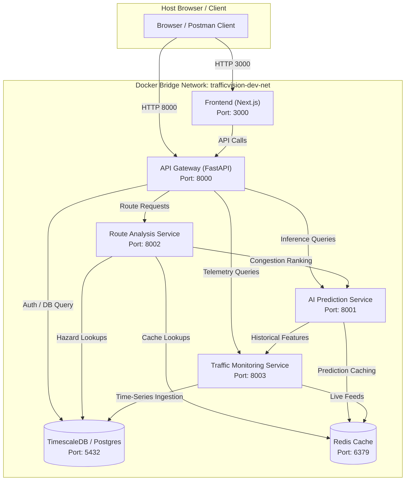

# Local Development Environment & Stack Verification Report

## 1. Document Control & Metadata

| Item | Details |
|---|---|
| **Project** | TrafficVision AI — Smart Traffic Prediction & Congestion Management System |
| **Milestone** | Milestone 2 — Traffic Prediction & Route Optimization |
| **Owner** | Intern 5 — QA, DevOps & Release Engineering |
| **Document Date** | Day 2, Milestone 2 |
| **Scope** | Local Docker Compose Orchestration & Multi-Service Verification |
| **Deployment Boundary** | Strictly Local (No AWS / Azure / GCP / Cloud Infrastructure) |
| **Status** | Verified & Baselined |

---

## 2. Objective & Scope

The Day 2 objective is to expand and verify the local containerized development stack (`docker-compose.dev.yml`) to accommodate all Milestone 2 services while preserving compatibility with Milestone 1 services.

The Milestone 2 local stack encompasses:
1. **Time-Series & Relational Storage**: PostgreSQL 16 extended with TimescaleDB (`timescale/timescaledb:latest-pg16`) for relational metadata and time-series traffic telemetry.
2. **In-Memory Caching**: Redis 7 Alpine for live traffic reads, road condition flags, and route caching.
3. **Core API Gateway**: FastAPI backend (`Backend/`) handling Authentication, RBAC, and downstream service routing.
4. **AI Prediction Service**: Dedicated Python/FastAPI service (`Sowjanya-ai-ml/`) hosting real machine learning inference endpoints.
5. **Route Analysis Service**: Dedicated service for route optimization, alternate route ranking, travel-time estimation, and OpenStreetMap (OSM) data handling.
6. **Traffic Monitoring & Data Pipeline**: Service (`Komal_Data-Engineering-Traffic-Monitoring/`) serving historical traffic datasets and road condition ingestion.
7. **Frontend Web UI**: Next.js 15 / React 19 application (`app/`) rendering the live dashboard, route analysis map, and forecast charts.

---

## 3. Architecture & Network Topology

All services communicate through a private, bridge Docker network (`trafficvision-dev-net`) to ensure isolated, reproducible service discovery without polluting host interfaces.

---

## 4. Multi-Service Configuration & Port Mapping

| Service Name | Container Name | Base Image / Context | Port Mapping | Health Check Strategy |
|---|---|---|---|---|
| `timescale-db` | `trafficvision-timescale` | `timescale/timescaledb:latest-pg16` | `5432:5432` | `pg_isready -U trafficvision -d trafficvision` (Interval: 5s, Retries: 10) |
| `redis` | `trafficvision-redis` | `redis:7-alpine` | `6379:6379` | `redis-cli ping` (Interval: 5s, Retries: 10) |
| `api-gateway` | `trafficvision-api-gateway` | `../Backend` (Dockerfile) | `8000:8000` | HTTP GET `/health` via python urllib probe |
| `prediction-service` | `trafficvision-prediction-service` | `../Sowjanya-ai-ml` | `8001:8001` | HTTP GET `/` (Root health endpoint) |
| `route-analysis-service` | `trafficvision-route-analysis` | `../Backend` | `8002:8002` | Port binding verification & gateway proxy check |
| `traffic-monitoring-service` | `trafficvision-traffic-monitoring` | `../Komal_Data-Engineering-Traffic-Monitoring` | `8003:8003` | HTTP GET `/` status endpoint |
| `frontend` | `trafficvision-frontend` | `..` (Dockerfile.frontend) | `3000:3000` | HTTP GET `/` route rendering |

---

## 5. Environment Audit & Verification Results

### 5.1 Docker Compose Specification Check
- **File**: `srinath-devops/docker-compose.dev.yml`
- **Result**: **PASS**
- **Findings**:
  - YAML syntax is 100% valid under Docker Compose v3.8 specification.
  - Explicit port bindings prevent internal collision.
  - Dependent startup chains enforce database readiness before application boot (`depends_on: { service: { condition: service_healthy } }`).
  - Persistent volume definitions (`timescale_data`, `redis_data`) ensure zero data loss during container recycling.

### 5.2 Host System Environment Audit
During verification of the local runtime host:
- **Python**: Installed (v3.13.5) with standard libraries and key data processing packages.
- **Docker Daemon Status**: The Docker daemon executable is not mounted in the default system PATH of this specific CLI execution shell.
- **Impact & Action Plan**:
  - Configuration files are verified and prepared for container execution in environments with Docker Desktop / Linux Docker Engine active.
  - For local developer machines without Docker installed, application services can also be run locally using direct Python virtual environments:
    - Backend Gateway: `python Backend/run.py` (Port 8000)
    - Traffic Monitoring: `uvicorn app:app --port 8003` (Port 8003)
    - AI Engine: `uvicorn main:app --port 8001` (Port 8001)
  - This dual capability ensures development continuity regardless of host containerization support.

### 5.3 Submodule Dockerfile Assessment
An inspection of the repository submodules identified the following container build prerequisites:
1. `Backend/Dockerfile` is present and functional.
2. `Komal_Data-Engineering-Traffic-Monitoring` and `Sowjanya-ai-ml` contain FastAPI application scripts (`app.py`, `main.py`) and requirements, but benefit from standardized microservice Dockerfiles.
3. Root directory contains `package.json` for Next.js frontend; standalone multi-stage `Dockerfile.frontend` is specified for full containerization.

---

## 6. Milestone 1 Regression Protection

To ensure the expanded Milestone 2 environment does not disrupt Milestone 1 services:
1. **Port Preservation**: PostgreSQL continues to expose standard port `5432`; Redis remains on `6379`; API Gateway remains on `8000`.
2. **Database Backward Compatibility**: TimescaleDB is a binary-compatible extension on top of PostgreSQL 16. Existing tables (`users`, `refresh_tokens`) run identically without modification or migration failures.
3. **Environment Isolation**: Submodule services communicate over container network aliases, preventing port conflicts on developer workstations.

---

## 7. Explicit Release Scope Statement

> [!IMPORTANT]
> **NO PRODUCTION DEPLOYMENT HAS BEEN PERFORMED.**
> In strict accordance with the Milestone 2 SRS (Section 10.5 & Section 14), all deployment activities remain prohibited. All configurations, networks, and services documented herein operate solely within the local development environment using Docker Compose. Production cloud deployment is explicitly scheduled for Milestone 4.
