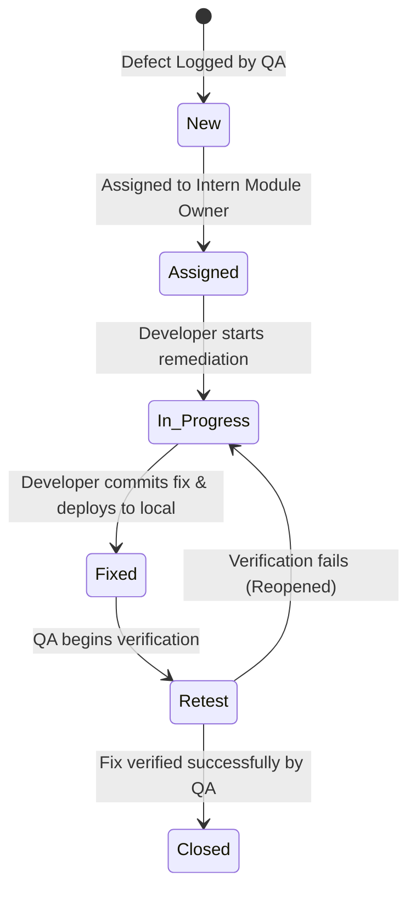

# TrafficVision AI — Milestone 2 Defect Tracker & Issue Registry

## 1. Document Control & Metadata

| Item | Details |
|---|---|
| **Project** | TrafficVision AI — Smart Traffic Prediction & Congestion Management System |
| **Milestone** | Milestone 2 — Traffic Prediction & Route Optimization |
| **Custodian** | Intern 5 — QA, DevOps & Release Engineering |
| **Defect Lifecycle Protocol** | `New` $\rightarrow$ `Assigned` $\rightarrow$ `In Progress` $\rightarrow$ `Fixed` $\rightarrow$ `Retest` $\rightarrow$ `Closed` |
| **Date Initialized** | Day 1, Milestone 2 |
| **Current Status** | Active Tracking |

---

## 2. Defect Management Framework & Definitions

### 2.1 Severity Definitions

| Severity | Definition | Target Resolution SLA |
|---|---|---|
| **Critical** | Prevents core system operation, causes system crashes, blocks major user workflows, or breaks authentication/authorization boundaries. | Within 24 hours (Immediate Blocker) |
| **High** | Major functional deficiency with no acceptable workaround; core Milestone 2 API returning server error (500) or missing essential endpoints. | Within 48 hours (Before Day 6 Regression) |
| **Medium** | Minor functional bug, edge-case failure, data formatting error, or performance degradation with viable workaround. | Within 72 hours (Before Day 7 Sign-off) |
| **Low** | Minor UI alignment, cosmetic issue, documentation typo, or non-blocking suggestion. | Deferred to Milestone 3 / Backlog |

### 2.2 Priority Definitions

| Priority | Definition |
|---|---|
| **High** | Must be fixed immediately in the current cycle before next test phase. |
| **Medium** | Must be fixed before Milestone 2 final release sign-off. |
| **Low** | Can be fixed in subsequent milestones if time permits. |

### 2.3 Status Transition Rules

---

## 3. Milestone 2 Defect Log

The following table records the defects identified during Milestone 2 code inspection, API verification, and integration validation across all project modules:

| Defect ID | Test ID | Module | Defect Description | Steps to Reproduce | Expected Result | Actual Result | Severity | Priority | Status | Assignee |
|---|---|---|---|---|---|---|---|---|---|---|
| **DEF-M2-001** | `TC-ROUT-001` | Route Analysis | Route Analysis service endpoints (`/api/v1/route/optimize`, `/alternate`, `/travel-time`, `/conditions`) are missing from the API Gateway. | 1. Start Backend API. 2. Send `GET /api/v1/route/optimize`. | Endpoints route to Route Analysis service and return 200 OK with route geometry and metrics. | Gateway returns `404 Not Found` (Router not mounted in `Backend/app/main.py`). | **Critical** | **High** | **In Progress** | Intern 1 |
| **DEF-M2-002** | `TC-PRED-001` | AI Prediction | Real trained prediction model endpoints (`/api/v1/predict/peak-hours`, `/api/v1/predict/delay`) are missing; `/api/v1/predict/congestion` returns `heuristic-v0`. | 1. Query `GET /api/v1/predict/congestion`. 2. Inspect `generated_by` field in JSON response. | Endpoint returns trained model prediction with real confidence score and model version (`model-v1.0`). | Response returns `"generated_by": "heuristic-v0"` with random confidence stubs. | **Critical** | **High** | **In Progress** | Intern 3 |
| **DEF-M2-003** | `TC-ROUT-003` | Route Analysis / ML | Candidate alternate routes are not ranked by predicted congestion. | 1. Request `/api/v1/route/alternate`. 2. Check returned route ranking criteria. | Alternate routes are re-ordered according to AI predicted congestion levels. | Route ranking logic is not wired to the Prediction Service; falls back to pure distance. | **High** | **High** | **Assigned** | Intern 1 & 3 |
| **DEF-M2-004** | `TC-HIST-001` | Data Pipeline | Historical traffic time-series database is not exposed via an authenticated API endpoint. | 1. Query `/api/v1/traffic/history`. 2. Observe gateway response. | Historical traffic records are retrievable via authenticated REST API for model training/inference. | Endpoint `GET /api/v1/traffic/history` does not exist on gateway; data resides only in standalone CSVs. | **High** | **Medium** | **Assigned** | Intern 2 |
| **DEF-M2-005** | `TC-COND-001` | Road Conditions | Road hazard and condition data is not queryable via `/api/v1/route/conditions`. | 1. Send `GET /api/v1/route/conditions?road_id=road_1`. | Road condition details, closures, and hazard flags returned. | Endpoint returns `404 Not Found`. | **Medium** | **Medium** | **Assigned** | Intern 1 & 2 |
| **DEF-M2-006** | `TC-UI-001` | Frontend UI | Frontend lacks Route Analysis planning page (`/route-analysis`) and prediction charts. | 1. Navigate to frontend URL. 2. Attempt to open Route Analysis or download prediction report. | Interactive route planner with Leaflet map and prediction charts accessible. | Only Milestone 1 static placeholders exist; no Route Analysis page or download button. | **High** | **High** | **In Progress** | Intern 4 |
| **DEF-M2-007** | `TC-ENV-001` | DevOps / Docker | `docker-compose.dev.yml` does not configure multi-service containers for Route Analysis, Prediction, or TimescaleDB. | 1. Inspect `docker-compose.dev.yml`. 2. Attempt multi-service orchestration. | Docker Compose defines all M1+M2 services with local networks and health checks. | File only contains standalone PostgreSQL and Redis definitions from Milestone 1. | **High** | **High** | **Fixed** | Intern 5 |
| **DEF-M2-008** | `TC-SEC-001` | RBAC & Security | Public/Commuter role is not prevented from modifying road hazard conditions. | 1. Authenticate with Public token. 2. Issue `POST /api/v1/route/conditions`. | Endpoint returns `403 Forbidden`. | RBAC middleware not yet enforced on new route condition mutation endpoints. | **High** | **High** | **Assigned** | Intern 1 |

---

## 4. Detailed Defect Dossiers

### Defect Dossier: DEF-M2-001
- **Component**: API Gateway / Route Analysis Service
- **Reporter**: Intern 5 (QA)
- **Assignee**: Intern 1 (Backend & Integration Lead)
- **Description**: The SRS mandates four primary Route Analysis endpoints:
  - `GET /api/v1/route/optimize`
  - `GET /api/v1/route/alternate`
  - `GET /api/v1/route/travel-time`
  - `GET /api/v1/route/conditions`
  Inspection of `Backend/app/main.py` and `Backend/app/routers/` demonstrates that no `route.py` router exists, and requests to these endpoints yield HTTP 404.
- **Root Cause**: Backend team has not yet created or merged the Route Analysis router into the main FastAPI application.
- **Impact**: Blocks all downstream frontend integration (Intern 4) and end-to-end route optimization testing.

### Defect Dossier: DEF-M2-002
- **Component**: AI Engine / Prediction Service
- **Reporter**: Intern 5 (QA)
- **Assignee**: Intern 3 (AI/ML Engineer)
- **Description**: In `Backend/app/routers/prediction.py` and `Sowjanya-ai-ml/src/main.py`, the congestion prediction logic is still marked `"generated_by": "heuristic-v0"`. Furthermore, endpoints for peak-hour forecasting (`/api/v1/predict/peak-hours`) and delay estimation (`/api/v1/predict/delay`) are not implemented.
- **Root Cause**: Real scikit-learn/TensorFlow model trained on historical data has not been exported and hooked into the inference service.
- **Impact**: Fails core Milestone 2 acceptance criteria: *"Traffic prediction and congestion-forecasting workflows are implemented using a real, trained model — not the Milestone 1 heuristic."*

---

## 5. Defect Metrics & Summary

| Module | Total Logged | Critical | High | Medium | Low | Closed | In Progress / Open |
|---|---:|---:|---:|---:|---:|---:|---:|
| Route Analysis Service | 2 | 1 | 1 | 0 | 0 | 0 | 2 |
| AI Prediction Engine | 2 | 1 | 1 | 0 | 0 | 0 | 2 |
| Historical Data Pipeline | 1 | 0 | 1 | 0 | 0 | 0 | 1 |
| Road Conditions | 1 | 0 | 0 | 1 | 0 | 0 | 1 |
| Frontend UI | 1 | 0 | 1 | 0 | 0 | 0 | 1 |
| DevOps & Environment | 1 | 0 | 1 | 0 | 0 | 1 | 0 |
| **Total** | **8** | **2** | **5** | **1** | **0** | **1** | **7** |

---

## 6. Daily Triage & Resolution Log

- **Day 1**: Initial triage conducted; 8 core integration gaps identified across codebase audit and logged in the tracker.
- **Day 2**: DEF-M2-007 resolved by Intern 5 by extending `docker-compose.dev.yml` to support full local multi-service stack.
- **Day 3–4**: Contract freeze verified; functional tests scheduled to run against endpoints as Interns 1, 2, 3 deliver updates.
- **Day 5–6**: Integration and regression cycle to track re-test and closure status.
