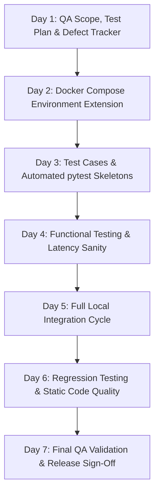

# TrafficVision AI — Milestone 2 Master Test Plan & QA Strategy

## 1. Document Control & Metadata

| Field | Value |
|---|---|
| **Project** | TrafficVision AI — Smart Traffic Prediction & Congestion Management System |
| **Milestone** | Milestone 2 — Traffic Prediction & Route Optimization |
| **Owner / Role** | Intern 5 — QA, DevOps & Release Engineering |
| **Environment** | Strictly Local Development (Docker Compose) |
| **Deployment Scope** | **None** — Production deployment strictly out of scope until Milestone 4 |
| **Document Version** | 2.0.0 |
| **Date** | Day 1, Milestone 2 |
| **Status** | Active / Baselined |

---

## 2. Executive Summary & Context

TrafficVision AI is an intelligent traffic prediction and congestion management platform designed to monitor real-time traffic, forecast congestion hotspots using machine learning, and optimize vehicular routes.

Milestone 1 successfully established:
- Core API Gateway skeleton in FastAPI.
- User Authentication (Registration, Login, Token Refresh) and Role-Based Access Control (RBAC: Admin, Operator, Public).
- Live Traffic Monitoring stubs and vehicle density tracking.
- Baseline heuristic prediction stub (`heuristic-v0`).
- Local Docker Compose configuration (`docker-compose.dev.yml`).
- Initial Next.js frontend structure and CI workflow skeleton.

**Milestone 2 expands the platform capabilities with:**
1. **Historical Traffic Data Pipeline & Time-Series Storage** (Intern 2): Multi-week historical sensor readings, schema design, database indexing, and aggregated speed/density data.
2. **Real Congestion Prediction & Forecasting Engine** (Intern 3): Replacing heuristic placeholders with a real trained ML model supporting congestion level prediction, peak-hour forecasting, and delay estimation.
3. **Route Analysis Service & Maps Integration** (Intern 1): Route optimization, travel-time estimation, alternate routes ranked by predicted congestion, road condition reporting, and OpenStreetMap (OSM) integration.
4. **Interactive Map & Prediction Visualizations** (Intern 4): Leaflet.js interactive map UI, Route Analysis page, congestion forecast charts, and downloadable prediction reports.
5. **Quality Assurance, Integration & DevOps** (Intern 5): Local multi-service environment extension, automated API test suites, functional and regression validation, static code quality checks, and milestone release sign-off without cloud deployment.

---

## 3. Milestone 1 QA Baseline Review

A retrospective review of the Milestone 1 QA baseline revealed:
- **Strengths**: Functional test structures established; RBAC permissions clearly partitioned; CI workflow skeleton configured for linting and test execution.
- **Identified Gaps to Address in Milestone 2**:
  - The Milestone 1 local Docker environment only ran standalone PostgreSQL and Redis containers, while application services were launched manually on host ports.
  - The prediction endpoint was a pure heuristic stub (`heuristic-v0`) using random float generators without data persistence.
  - Test suites relied on manual invocation and required automated test skeletons targeting frozen API contracts.
  - Milestone 2 introduces inter-service dependencies (Prediction $\leftrightarrow$ Route Analysis $\leftrightarrow$ Historical DB $\leftrightarrow$ Frontend), demanding formal integration test procedures.

---

## 4. Milestone 2 Testing Scope

### 4.1 In-Scope Components & Services

| Service / Module | Owner | In-Scope Features for Testing |
|---|---|---|
| **Route Analysis Service** | Intern 1 | `/api/v1/route/optimize`, `/api/v1/route/alternate`, `/api/v1/route/travel-time`, `/api/v1/route/conditions`, Maps API integration (OSM) |
| **AI Prediction Service** | Intern 3 | `/api/v1/predict/congestion`, `/api/v1/predict/peak-hours`, `/api/v1/predict/delay`, Model latency, accuracy sanity, feature extraction |
| **Historical Data & Storage** | Intern 2 | Time-series database schemas, historical traffic ingestion, data cleanliness, aggregated hourly metrics, road condition records |
| **Frontend Application** | Intern 4 | Interactive map rendering (Leaflet.js), Route planning screen, Prediction charts, Report download button, error/loading states |
| **API Gateway & Core** | Intern 1 | Gateway routing to Route Analysis and Prediction services, CORS policy, centralized error handling |
| **Authentication & RBAC** | Intern 1 | Regression of login/registration/JWT lifecycle; verification of RBAC boundaries on all newly added M2 endpoints |
| **Local Environment** | Intern 5 | Extended `docker-compose.dev.yml` supporting multi-service orchestration locally |

### 4.2 Out-of-Scope Items

- **Production Cloud Deployment**: No AWS, Azure, GCP, Kubernetes, or hosted cloud resources.
- **Paid Third-Party APIs**: No paid Google Maps billing accounts or commercial traffic APIs. Only free/open-source solutions (OpenStreetMap, Leaflet.js) are permitted.
- **Milestone 3 & 4 Features**: Dynamic automated signal control, emergency vehicle preemption, and edge computing.

---

## 5. Testing Strategy & Methodologies

The Milestone 2 QA strategy implements a multi-tiered testing hierarchy:

```
                  ┌─────────────────────────────────┐
                  │    Day 7: Final QA Sign-Off     │
                  └────────────────┬────────────────┘
                                   │
                  ┌────────────────┴────────────────┐
                  │  Day 6: Regression & Code Qual  │
                  └────────────────┬────────────────┘
                                   │
                  ┌────────────────┴────────────────┐
                  │ Day 5: Full Local Integration   │
                  └────────────────┬────────────────┘
                                   │
                  ┌────────────────┴────────────────┐
                  │ Day 4: Functional Test Exec     │
                  └────────────────┬────────────────┘
                                   │
                  ┌────────────────┴────────────────┐
                  │ Day 3: Automated Test Skeleton  │
                  └────────────────┬────────────────┘
                                   │
                  ┌────────────────┴────────────────┐
                  │ Day 2: Docker Environment Setup │
                  └────────────────┬────────────────┘
                                   │
                  ┌────────────────┴────────────────┐
                  │  Day 1: Test Plan & Defect Log  │
                  └─────────────────────────────────┘
```

### 5.1 Test Categories

1. **Functional Testing**:
   - Verify that business logic requirements for route optimization, alternate route generation, travel-time computation, and congestion prediction match the SRS.
   - Verify boundary conditions (e.g., origin equals destination, 0 density, peak vs. off-peak hours).

2. **API & Contract Testing**:
   - Validate HTTP status codes (200, 201, 400, 401, 403, 404, 422, 500).
   - Validate JSON payload structure, mandatory keys, data types, and null handling.
   - Validate that response schemas conform to frozen contracts agreed upon by Day 2.

3. **Integration Testing**:
   - Inter-service communication: API Gateway $\rightarrow$ Route Analysis $\rightarrow$ Prediction Service.
   - Route ranking logic: Ensure candidate routes from Route Analysis are ranked according to ML-predicted congestion rather than pure spatial distance.
   - Historical data flow: Ensure historical traffic summaries feed into the Prediction Service training/inference pipelines.
   - Frontend $\leftrightarrow$ Backend: Ensure UI components fetch and render live data from route and prediction endpoints.

4. **Regression Testing**:
   - Ensure zero breakage of Milestone 1 deliverables:
     - User registration, login, token refresh, `/api/v1/auth/me`.
     - RBAC protections on traffic monitoring endpoints.
     - Live sensor feeds and density metrics (`/api/v1/traffic/live`, `/api/v1/traffic/density`).

5. **RBAC & Security Testing**:
   - Re-evaluate role permissions across all new endpoints:
     - `Admin`: Full configuration, user management, and operational override.
     - `Operator`: Full route analysis, road condition updates, prediction analytics.
     - `Public / Commuter`: Read-only access to route planning, public predictions, and travel-time estimates.

6. **Performance & Latency Sanity Checks**:
   - Prediction latency target: **~1–2 seconds per inference request** as mandated by the SRS.
   - Route optimization execution time over realistic coordinate pairs.
   - Database query execution times for historical time-series lookups.

7. **Error Handling & Resilience**:
   - Verify graceful degradation when OpenStreetMap tiles fail or timeout.
   - Verify fallback behavior when the Prediction Service is unavailable (e.g., fallback to distance-based routing or cached heuristics).
   - Validation errors for malformed coordinates, missing query parameters, and invalid sensor IDs.

8. **Static Code Quality Checks**:
   - Python code compliance: `black --check` (formatting), `flake8` (linting/PEP8).
   - Frontend code compliance: `npm run lint` (`eslint`).

---

## 6. Test Environment & Tooling Stack

All testing and execution activities utilize 100% free and open-source tools:

| Category | Tool / Technology | Version / Specification | Purpose |
|---|---|---|---|
| **Test Runner** | pytest | 7.x / 8.x | Automated unit, API, and integration test execution |
| **HTTP Client** | requests / httpx | Latest stable | Scripted REST API endpoint assertions |
| **API Collections** | Postman / pytest | Postman v2.1 schema | Shared API contract repository |
| **Containerization** | Docker & Docker Compose | Docker 24+, Compose v2 | Local multi-service environment orchestration |
| **Database** | PostgreSQL + TimescaleDB | PG 16 / Timescale latest-pg16 | Relational metadata & time-series storage |
| **Cache** | Redis | 7-alpine | In-memory caching for live traffic & conditions |
| **Code Quality** | Black, Flake8, ESLint | Latest standard | Automated static code analysis & linting |
| **CI Engine** | GitHub Actions | Ubuntu-latest | PR verification (lint, build, automated tests) |

---

## 7. Day-by-Day QA Execution Schedule & Quality Gates



### Day 1: Test Planning & Defect Framework
- **Deliverables**: `M2_TEST_PLAN.md`, `M2_DEFECT_TRACKER.md`.
- **Quality Gate**: Test plan reviewed; defect tracking fields and lifecycle agreed upon by team.

### Day 2: Local Environment Extension
- **Deliverables**: Extended `docker-compose.dev.yml`, `LOCAL_ENVIRONMENT_VERIFICATION.md`.
- **Quality Gate**: Multi-service Docker Compose file starts PostgreSQL, TimescaleDB, Redis, Backend, and new service skeletons without port collisions.

### Day 3: Test Specification & Automation Skeleton
- **Deliverables**: `M2_TEST_CASES.md`, `API_TEST_AUTOMATION/` suite.
- **Quality Gate**: Test cases cover all 7 mandatory M2 endpoints, edge cases, RBAC matrices, and automated test scripts are runnable via `pytest`.

### Day 4: Functional Test Execution & Defect Logging
- **Deliverables**: `DAY4_FUNCTIONAL_TEST_REPORT.md`, `DAY4_DEFECT_LOG.md`.
- **Quality Gate**: Functional tests executed against available service endpoints; actual response times recorded; defects triaged with priority.

### Day 5: Full Local Integration Testing
- **Deliverables**: `DAY5_FULL_INTEGRATION_TEST_REPORT.md`, `DAY5_PRIORITIZED_DEFECT_LIST.md`.
- **Quality Gate**: End-to-end journey validated (Auth $\rightarrow$ Live Dashboard $\rightarrow$ Route Planning $\rightarrow$ Congestion-aware Ranking $\rightarrow$ Prediction Report); prioritized defect list delivered for Day 6 remediation.

### Day 6: Regression Testing & Static Code Quality
- **Deliverables**: `DAY6_REGRESSION_TEST_REPORT.md`, `DAY6_CODE_QUALITY_REPORT.md`.
- **Quality Gate**: Milestone 1 features 100% verified against regression; Black, Flake8, and ESLint checks run and documented.

### Day 7: Final QA Sign-Off & Test Summary
- **Deliverables**: `DAY7_FINAL_QA_SIGN_OFF_REPORT.md`, `DAY7_MILESTONE2_TEST_SUMMARY.md`.
- **Quality Gate**: Formal audit of test execution counts, defect backlog status, performance benchmarks, and release recommendation.

---

## 8. Defect Management Protocol

### 8.1 Defect Lifecycle
Defects follow a strict, deterministic lifecycle:

```
[ New ] ──► [ Assigned ] ──► [ In Progress ] ──► [ Fixed ] ──► [ Retest ] ──► [ Closed ]
                                                      │              │
                                                      └──────────────┴──► [ Reopened ]
```

### 8.2 Severity & Priority Classification

| Severity Level | Definition | SLA / Impact |
|---|---|---|
| **Critical** | Complete service outage, data corruption, broken authentication, or crash in primary user journey. | Must fix immediately; blocks milestone release. |
| **High** | Major functional defect with no viable workaround (e.g., route optimization returns 500 error). | Must fix before Day 7 sign-off. |
| **Medium** | Non-critical functional defect with available workaround (e.g., incorrect confidence score formatting). | Target fix before Day 6 regression. |
| **Low** | Cosmetic, formatting, or minor documentation inconsistency. | Deferred to Milestone 3 backlog if necessary. |

---

## 9. Risk Management & Mitigations

| Risk Identified | Impact | Probability | Mitigation Strategy |
|---|---|---|---|
| **Prediction model training latency exceeds schedule** | High | Medium | Timebox training to Day 2; maintain Milestone 1 heuristic stub as documented fallback while logging defect for real model integration. |
| **Synthetic historical traffic data lacks realism** | Medium | Low | Document synthetic data assumptions; validate pipeline throughput and schema integrity rather than absolute real-world distribution. |
| **Rate limits or downtime in external map services** | Medium | Medium | Standardize on free OpenStreetMap / Nominatim with local caching and mocked coordinate responses for automated CI tests. |
| **Route analysis + Prediction integration exceeds 2s target** | High | High | Implement response caching in Redis for frequent OD (origin-destination) pairs; profile prediction inference pipeline. |
| **Milestone 2 changes break Milestone 1 Auth/Monitoring** | High | Medium | Maintain dedicated regression test suites executed on Day 6; require green regression pass before release sign-off. |
| **Accidental cloud deployment attempts** | Critical | Low | Hardcode local Docker Compose boundaries; strictly forbid cloud CLI tools or deployment scripts in repository. |

---

## 10. QA Governance & Sign-Off Criteria

Milestone 2 QA approval requires:
1. All planned test cases executed with conclusive results (`PASS`, `FAIL`, or `BLOCKED` with documented dependencies).
2. Zero open **Critical** or **High** severity defects impacting core functional flows.
3. Successful demonstration of the end-to-end integration workflow on local Docker Compose.
4. Confirmed regression stability of all Milestone 1 features.
5. All deliverables generated, reviewed, and signed off by QA and Team Lead.
